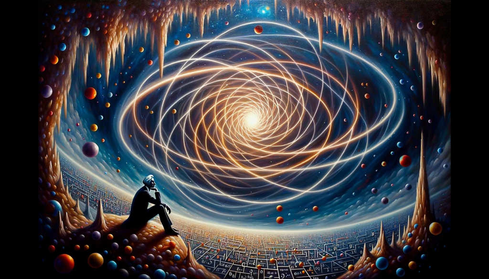

*Engage with Us on [X-Twitter](https://twitter.com/Amaral12358) or [LinkedIn](https://www.linkedin.com/in/marcelo-maciel-amaral-344842162/)*

In this post, we’ll delve into the quantum legacy of Paul Dirac. From the concept of spin and the prediction of antimatter to the transformation of the scientific method itself, Dirac’s work has fundamentally reshaped our understanding of physics and natural laws.

*Marcelo Amaral with special thanks to ChatGPT for editorial assistance.*

{fig-alt="What is spin?"}

Nearly two decades ago, I had the privilege of attending classes taught by Professor J. A. Helayël-Neto in Rio de Janeiro. It was there that I first heard the term ‘Diracnists.’ Identifying myself as one has sparked my interest in the subject, which is the focus of today’s blog post. I will explore how Paul Dirac’s foundational work in the late 1920s not only advanced quantum mechanics but also significantly influenced the scientific method itself. His 1939 lecture, “The Relation between Mathematics and Physics,” serves as a potent lens through which to view Dirac’s enduring impact on our understanding of the natural world.

## What Is Spin?

Paul Dirac’s quantum legacy provides a groundbreaking explanation for the concept of spin. In classical physics, spin is often likened to Earth rotating on its axis—a metaphor that’s easy to grasp. However, quantum mechanics shows that spin defies such straightforward analogies. Paul Dirac, in his groundbreaking 1928 paper ‘The Quantum Theory of the Electron,’ offered a new perspective that reconciled quantum mechanics with special relativity. This reconciliation elevated spin from an enigmatic property to a geometric quality inherent to spacetime itself. This opened the door to further understanding the quantization of spacetime, a problem only recently addressed within the framework of loop quantum gravity. Here, spin networks serve as the fabric of quantum spacetime. On another front, Dirac’s equation, essentially the relativistic equation for the electron’s spin, laid the foundation stone for the Standard Model of particle physics, providing the first-ever relativistic description of a fundamental particle and setting the stage for a new era of scientific discovery.

## Dirac’s Equation and the Prediction of Antimatter

Dirac’s equation wasn’t merely a theoretical framework for understanding spin; it also boldly predicted the existence of antimatter, specifically an “anti-electron” later known as the positron. This prediction was so revolutionary that Dirac hesitated to discuss it publicly until it was experimentally verified by Carl Anderson in 1932. The discovery of the positron was a monumental step, validating Dirac’s theories and expanding our understanding of the fundamental components of the universe.

## A Philosophical Upside-Down Shift in the Scientific Method

Paul Dirac introduced a paradigm shift in the scientific method that continues to influence how we approach complex questions in quantum mechanics. Before Paul Dirac’s contributions, the scientific method had followed a linear course: observation led to hypothesis formulation, which in turn led to theoretical development and experimental verification. Dirac upended this established paradigm by drawing on Platonic principles that espouse the mathematical nature of reality. Dirac made a strong case for the heuristic power of mathematical elegance in discovering fundamental physical laws. His approach brought a deeply philosophical perspective to the scientific method, suggesting that the universe is inherently mathematical in its structure. Essentially, Dirac advocated for an ‘inverse Galilean method’: start with a compelling idea, clothe it in rigorous mathematics, and then search for its physical manifestations.

## Dirac’s 1939 Lecture: Unifying Mathematics and Physics

As part of his quantum legacy, Paul Dirac’s 1939 lecture touched on the profound relationship between mathematical reasoning and physical phenomena. In this pivotal work, Dirac outlined two main avenues for advancing the field of physics: experimental inquiry and mathematical reasoning. He stressed that the earlier emphasis on simplicity in physical laws had evolved into a quest for mathematical beauty, a shift particularly prompted by the introduction of General Relativity. Dirac also emphasized the inherent elegance of quantum mechanics, which incorporates non-commutative algebra and demands the inclusion of new mathematical frameworks. He went on to note that quantum jumps have replaced initial conditions as the unpredictable aspects of natural phenomena, overturning traditional mechanistic views. Most ambitiously, Dirac contemplated a future where pure mathematics and physics could be entirely unified, driving each other forward in a mutually enriching relationship. He eloquently summed up this vision by stating, “One may describe the situation by saying that mathematicians play a game in which they themselves invent the rules, while physicists play a game in which the rules are provided by Nature. However, as time progresses, it becomes increasingly clear that the rules the mathematicians find intriguing are the very same rules that Nature has chosen.”

## Complexity: The Next Frontier?

Building on Paul Dirac’s principles, modern computational methods now allow us to explore the next frontier in complexity and the evolution of natural laws. Mathematical reasoning and code have evolved into the platforms where scientific hypotheses are first tested, often well before experimental confirmation. This introduces a nuanced layer of complexity to Dirac’s original ideas, serving as a new stepping stone in our pursuit to decode the fabric of the universe. Echoing Dirac’s own shift from ‘the principle of simplicity to the principle of mathematical beauty,’ we find ourselves at a similar crossroads today. It may be time to transition once more—this time to a ‘code-theoretic’ framework. In this view, the laws of Nature are not static but continually evolving. This provides a fresh perspective for understanding emergent phenomena and addressing the unification of quantum gravity with other quantum gauge phenomena.

## Conclusion

Paul Dirac’s contributions extended far beyond equations and predictions. He reshaped our understanding of the scientific process itself. As we continue to explore increasingly complex questions, the philosophical foundations that Dirac laid remain as relevant as ever, serving both as a guide and as a challenge for future explorations.

If there’s a specific concept mentioned in this post that you’d like me to delve deeper into, please feel free to let me know. You can send me a [message](../../../../contact/index.qmd), or leave a comment on [LinkedIn](https://www.linkedin.com/in/marcelo-maciel-amaral-344842162/) or [Platform X](https://twitter.com/Amaral12358). I’m open to preparing a future post based on your interests and questions.

## References

- [The Quantum Theory of the Electron – Paul Dirac](https://royalsocietypublishing.org/doi/10.1098/rspa.1928.0023)
- [Paul Dirac’s 1939 Lecture: The Relation between Mathematics and Physics](https://www.damtp.cam.ac.uk/events/strings02/dirac/speach.html)

*Engage with Us on [X-Twitter](https://twitter.com/Amaral12358) or [LinkedIn](https://www.linkedin.com/in/marcelo-maciel-amaral-344842162/)*
