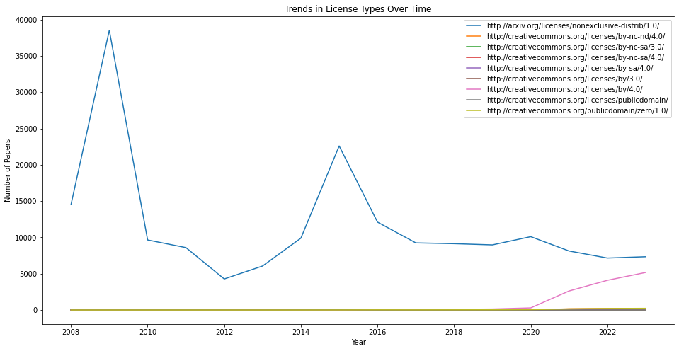

*Engage with Us on [X-Twitter](https://twitter.com/Amaral12358) or [LinkedIn](https://www.linkedin.com/in/marcelo-maciel-amaral-344842162/)*

## Introduction

In the expansive landscape of scientific inquiry, particularly within the fields of mathematics, physics, and computer science, the terms ‘open access’ and ‘open source’ often become intertwined, sometimes leading to misunderstandings. Open access ensures that research is freely accessible to all, while open source deepens this commitment by allowing modifications and repurposing of the content. Platforms like arXiv have long stood as pillars of open access in scholarly communication. However, one must question if they truly embody the essence of open source. Specifically, is arXiv open source in its approach to sharing and licensing content?

The recent global pandemic has magnified the urgency for unobstructed knowledge dissemination. This renewed emphasis on open source has led researchers to reevaluate the licensing agreements associated with their contributions. Nonetheless, it’s crucial to recognize that not every piece labeled as open access adheres to open source’s ideals; a case in point is arXiv’s default license. While it offers accessibility, it imposes constraints on content modification and reuse.

Recent shifts paint an optimistic picture for open source’s future, yet emerging dissent serves as a stark reminder that the journey is ongoing. Amidst these dynamic changes, the onus is on the scientific fraternity to rally and advocate for the genuine spirit of open source. In this article, we probe the depths of arXiv metadata, with a specific lens on high-energy physics (hep-th) and general relativity and quantum cosmology (gr-qc). Our exploration illuminates licensing trajectories, the ripple effects of the COVID-19 pandemic, and charts the prospective path for open source in the scholarly domain.

## Methodology for Analysis

**Data Source:** We procured our dataset from Kaggle, dated October 4, 2023. This comprehensive dataset weighs in at 3.9Gb and boasts a remarkable 2,335,589 records, offering a sweeping overview of arXiv’s content.

**Data Preprocessing:** To hone in on our areas of interest, we sieved out data specific to the ‘hep-th’ and ‘gr-qc’ categories. This refinement yielded a focused dataset of 217,930 entries.

**Analysis Objectives:** Our primary goal was to trace the evolution of licensing choices over time and spotlight any discernible trends.

The conclusions drawn from this meticulous analysis are fortified by a supplementary computational essay. This essay is paired with a Python Jupyter notebook, providing a comprehensive breakdown of our observations. Readers are invited to delve into this notebook, available at the end of this piece.

## Key Observations

The graph, titled “Trends in License Types Over Time”, serves as a visual narrative, shedding light on the shifting sands of licensing preferences on arXiv spanning the years 2008 to 2022.

{fig-alt="Trends in License Types in arXiv Over Time"}

*License Distribution:*

- Our in-depth analysis revealed a **compelling predominance of the Non-Exclusive Distribution License on arXiv papers**. Its overwhelming preference is evident, towering significantly above its closest contender, the Creative Commons BY 4.0 license. This dominance underscores the historical gravitation towards an open-access but not necessarily open-source framework.
- **Creative Commons BY 4.0 as a Strong Contender:** While the Non-Exclusive Distribution License took the limelight, it’s worth noting the consistent presence of the Creative Commons BY 4.0 license. This license promotes not only open access but also the freedom to share and adapt the research, resonating with a more open-source ethos. This indicate a path for arXiv open source.

*Temporal Licensing Patterns:*

- A detailed year-on-year analysis painted an interesting trajectory for the Non-Exclusive Distribution License. Up until 2020, this license witnessed a reasonably stable yearly average, with distinctive peaks observed in 2008 and 2015. These spikes may correlate with internal changes in the arXiv system, possibly tied to file regeneration processes that resulted in updated publication dates.
- The period after 2020 ushered in some intriguing shifts. We noticed a clear surge in the adoption rates of the Creative Commons BY 4.0 license. This could be an aftermath of the global push for open-source research during the pandemic, emphasizing more transparent and collaborative scientific endeavors.
- The rest of the license types, represented by different colored lines, seem to maintain a relatively stable yet minimal presence over the years.

## Historical Licensing Context

Before January 2004, arXiv did not have an explicit process for license granting or certification during submission. The platform operated under the presumption that by actively submitting, and given the content available on their help pages outlining submission archival policies, authors were inherently granting a license equivalent to the Non-Exclusive Distribution License. The evident 2009 peak can be attributed to the new licensing system, coupled with possible updates to older papers’ publication dates.

## Future Implications

The post-COVID-19 phase unveiled a tilt away from traditional licensing on arXiv, leaning more towards open-source-focused licenses. This shift underscores the heightened emphasis on making scientific knowledge universally accessible.

## Open Source’s Significance

The recent pandemic spotlighted the indispensable value of open-source platforms, capturing the gaze of even those previously unaware. As the adoption of conventional licenses reaches a plateau, the clamor for universally accessible scientific information intensifies. The virtues of open source encompass:

- Accelerating the pace of scientific advancements.
- Leveling the playing field through democratized access to knowledge.
- Catalyzing collaborations across varied disciplines.

The journey towards arXiv open source and a genuine open source ethos in scientific research is both laudable and complex. Transitioning from established academic norms necessitates a multifaceted strategy:

1. **AI and LLM Synergy:** The current wave of open-source adoption in artificial intelligence, particularly with large language models, presents a golden opportunity. The proliferation of sophisticated models on platforms like GitHub showcases the potential of open-source collaboration. Major corporations embracing these trends further validate the importance and viability of open-sourced AI research. This momentum should be leveraged to advocate for similar openness in other scientific domains.
2. **Education and Advocacy:** There’s an urgent need to educate both seasoned and upcoming researchers about the profound benefits of open source. Grasping its long-term societal and academic advantages can be instrumental in accelerating its adoption.
3. **Quality Control:** With a shift towards open source, the establishment of robust peer-review systems and stringent quality assurance mechanisms is paramount. The integrity and rigor of scientific research must remain uncompromised, further supporting the open source argument.
4. **Policy Adaptation:** Key stakeholders, including institutions, journals, and funding agencies, should re-envision and adapt their policies to champion open-source submissions. Incentivizing or recognizing researchers who adopt open-source licenses can provide the necessary motivation.
5. **Community Collaboration:** Achieving open source ubiquity isn’t the sole responsibility of individual entities. Collective effort is the key. Platforms like arXiv can spearhead this transformation by initiating dialogues, workshops, and forums, enabling the scientific community to discuss best practices and define the future course.

In an era marked by digital collaboration and monumental global challenges, democratizing scientific knowledge is not merely a commendable pursuit—it’s an imperative. By embracing a culture of open-source research, synergizing with the AI revolution, and forging strong community ties, we can catalyze scientific innovations and shape a more inclusive and accessible future.

## Appendix: Envisioning a Peer-reviewed arXiv?

arXiv’s vast repository stands as a testament to the power of collective knowledge sharing, amassing a staggering 2,335,589 papers that are freely accessible to the world. While this open-access platform has facilitated a revolution in scientific dissemination, it is often viewed as a pre-peer-review repository, where the validity and quality of content await community vetting.

In the conventional publication model, the peer-review process, crucial for maintaining the rigor and authenticity of scientific literature, predominantly hinges on voluntary contributions from the scientific community. However, the intricate task of matching manuscripts with appropriate reviewers is both time-consuming and labor-intensive.

Enter Large Language Models (LLMs). With advancements in AI, LLMs have the potential to automate and refine the reviewer-matching process, ensuring that manuscripts are reviewed by experts with the most relevant expertise. Moreover, LLMs can assist in initial content screening, flagging potential issues or inconsistencies for human reviewers to address.

Why not envisage a new platform—an enhanced arXiv open source—that integrates rigorous peer review, leveraging the capabilities of LLMs? Such a platform could offer the best of both worlds: the growing openness and full accessibility of arXiv, coupled with the quality assurance of traditional journals. This approach might further democratize the publication process by reducing the costs often associated with open-source publishing in many prominent journals.

While the idea is promising, its execution would entail numerous challenges, from defining the roles of LLMs in the peer-review process to ensuring the credibility and integrity of reviews, and addressing the costs of maintaining such a public platform. Nonetheless, in an era where technology and science are inextricably linked, bold initiatives like this could pave the way for a more inclusive, efficient, and democratized scientific publishing landscape.

This vision certainly warrants deeper exploration, a topic we hope to delve into in future discussions.

## Reference

[Computational Essay](https://github.com/macielamaral/computational_essays/blob/main/Tutorial_Arxiv_Data_Analisys_Physics_Licensing.ipynb).

*Engage with Us on [X-Twitter](https://twitter.com/Amaral12358) or [LinkedIn](https://www.linkedin.com/in/marcelo-maciel-amaral-344842162/)*
