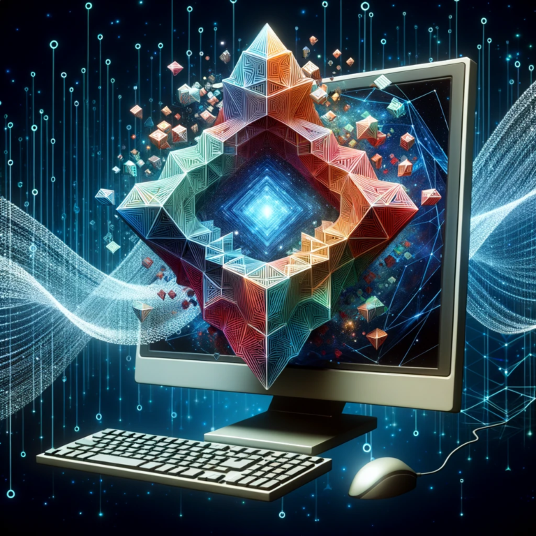

*Engage with Us on [X-Twitter](https://twitter.com/Amaral12358) or [LinkedIn](https://www.linkedin.com/in/marcelo-maciel-amaral-344842162/)*

## Introduction

As advancements in Large Language Models (LLMs) fuel discussions about the impending emergence of Artificial General Intelligence (AGI), the necessity for a more encompassing theoretical foundation becomes increasingly evident. The current chatter around AGI underscores the urgent need for a novel framework that can guide its development. The central premise is that we require a code capable of self-awareness and evolution, all while preserving its core identity constraints.

{fig-alt="Illustration of a monitor displaying quasicrystal geometry and digital waves"}

In collaboration with GPT, this article serves as a foundational exposition. It sets the stage for an in-depth exploration of interrelated concepts in subsequent discussions. Our insights are influenced by a GPT-generated translation of the Tao Te Ching, an ancient Chinese text. This text posits that reality is a rich tapestry woven from both well-defined elements and elusive, undefined spaces. While traditional paradigms often focus solely on concrete systems and structures, the Tao Te Ching encourages us to appreciate the wisdom inherent in the unknown.

With this in mind, we introduce the concept of “meta-coding,” an overarching framework that aims to bridge the gap between latent possibilities and manifested realities. Unlike traditional coding theories confined to the realm of computer science, meta-coding seeks a broader, more generalizable notion of code—one that can act as a conduit for potential information, channeling it into actual, tangible outcomes.

By synthesizing these perspectives, we aspire to broaden our understanding of codes and coding, propelling us closer to a future where information systems are not just functionally integrated but also philosophically unified.

## The Need for Meta-Coding

As we stand on the brink of achieving AGI, the importance of a unified coding theory becomes increasingly apparent. Existing coding theories, confined to specific domains such as physics, biology, or computer science, fail to provide a comprehensive understanding that AGI would demand. AGI is not just another computational entity; it represents the pinnacle of coding sophistication, an entity that would be capable of understanding, learning, and potentially modifying its own code while maintaining core identity constraints.

In this intricate landscape of overlapping coding systems—be they physical laws, biological processes, or computational algorithms—meta-coding emerges as a higher-order architecture. Far from simply collating existing codes, meta-coding aspires to synthesize them into a holistic framework, transcending their individual limitations. It endeavors to capture not just the tangible systems that dominate our current understanding, but also the nebulous, elusive interstices that traditional codes overlook.

In essence, meta-coding seeks to be a governing code for AGI, providing a cohesive layer of interpretation and transformation between disparate information systems. It’s a framework that can navigate the complexity of life, evolution, and even the universe itself, adapting and evolving while preserving the fundamental rules that define its ontology.

Thus, in the dawn of AGI  a comprehensive meta-coding theory holds the promise of not just facilitating the integration of various coding systems but of creating a unified philosophical underpinning for the next frontier of computational intelligence.

## What is Meta-Coding?

In an era where AGI is no longer just a subject of theoretical speculation but an imminent reality, our understanding of codes demands reevaluation. Codes underpin every facet of our existence—whether in mathematics, physics, biology, or even the metaphysical realms of philosophy. Fundamentally, what is a code? At its broadest, a code is a compilation of symbols governed by rules that dictate their manipulation. It serves as a conduit for transmitting information or directives in a format that can be readily employed or deciphered. At its core, the act of coding is transformative; it marks a shift from one state to another, from latent possibilities to manifested realities. However, traditional coding theory remains largely compartmentalized, focusing on domain-specific applications such as data compression, cryptography, and error control.

Enter Meta-Coding Theory—a conceptual framework aiming to unify these disparate domains. Unlike traditional coding theory, Meta-Coding is not merely an assembly of existing paradigms but a synthesis. It seeks to serve as a lingua franca across a multitude of disciplines, fostering cross-disciplinary dialogue that could redefine our approach to complex systems.

The implications of Meta-Coding Theory are far-reaching and potentially transformative, especially in the field of AGI development. By establishing a unified coding framework, we not only facilitate the creation of an AGI system capable of understanding and integrating various aspects of reality, but we also open the door for it to evolve within defined ethical and logical constraints.

## Research Frontiers in Meta-Coding: Navigating the Road to AGI

As we stand on the brink of ushering in an era dominated by AGI, the need for a comprehensive theoretical underpinning becomes ever more critical. Meta-Coding Theory, enriched by frameworks like Homotopy Type Theory (HoTT) and inspirations from the realm of quasicrystals, presents a multidimensional approach to meeting this imperative.

*HoTT and AGI: Pioneering Fluid Codes*

HoTT offers a mathematical lexicon for creating fluid codes—programs that can evolve without losing their core essence. This fluidity may provide a foundational block for AGI, allowing it to adapt and learn while maintaining underlying ethical and logical constraints.

*Higher-Order Thinking for AGI*

One of the most challenging aspects of AGI is enabling it to think abstractly. HoTT’s emphasis on higher-order abstractions introduces a nuanced layer of complexity into Meta-Coding Theory, making it an ideal candidate for shaping the cognitive framework of AGI systems.

*Computational Unification: Bridging Paradigms*

AGI, as a concept, transcends the limitations of classical computing and even ventures into the quantum realm. HoTT serves as a unifying force, integrating various computational paradigms from classical and quantum to biological computing, thereby laying a versatile groundwork for AGI.

*Geometry and Code: The Quasicrystal Connection*

The unique geometry of quasicrystals offers intriguing avenues for advanced coding theories. Viewed as dynamic, geometrically ordered, yet aperiodic codes, quasicrystals could play a role in the multidimensional information processing required by AGI.

*Intersecting HoTT and Quasicrystals*

The expressive power of HoTT, particularly its ability to articulate complex, multi-dimensional spaces, complements the geometry of quasicrystals. Together, they can offer profound insights into the very nature of meta-coding, which will be indispensable in AGI development.

*Scope and Potential of Meta-Coding in AGI*

Ultimately, Meta-Coding Theory strives to be more than just a unifying framework. By weaving together algorithms, genetic codes, geometries like quasicrystals, and even the lofty theories of quantum gravity, it aims to build the intellectual scaffolding upon which the AGI of tomorrow may be responsibly constructed and ethically guided.

## Conclusion

As we edge closer to the realization of AGI, the quest for a rigorous theoretical framework takes on existential importance. Meta-Coding Theory, bolstered by insights from HoTT and the complex geometries of quasicrystals, is poised to meet this challenge.

*Computational Experiments: The Next Frontier*

We’re keen on embarking upon computational experiments that leverage these principles. Specifically, we want to investigate the properties of quasicrystals and their potential applications in AGI models. How could these natural structures inform a computational system that is as versatile as it is robust? How might HoTT interact with these principles to create AGI systems capable of multi-dimensional reasoning and adaptive learning?

*Beyond Adaptive Learning: Ethical and Logical Foundations*

The interplay between HoTT and meta-coding provides a visionary roadmap for AGI. This isn’t just about creating machines that learn; it’s about building systems that can understand, adapt, and operate within ethical and logical boundaries, thus providing a scalable approach to AGI that aligns with human values.

*A Grand Synthesis for a Coded Reality*

In closing, our pursuit of Meta-Coding Theory represents a grand synthesis, aiming to unify diverse scientific disciplines while deepening our existential grasp of a coded, yet endlessly enigmatic, reality. Drawing inspiration from the Tao Te Ching, we understand that the path to wisdom lies not only in dissecting what is known but also in courageously venturing into the unknown. It is in this liminal space that Meta-Coding Theory operates, acting as a conduit between the possible and the real, and guiding us responsibly into the era of AGI.

## References

- [HoTT](https://homotopytypetheory.org/book/)
- [Self-simulation hypothesis](https://www.mdpi.com/1099-4300/22/2/247)
- [Quasicrystals codes](https://ncatlab.org/nlab/show/quasicrystal)
- [AGI](https://en.wikipedia.org/wiki/Artificial_general_intelligence)
