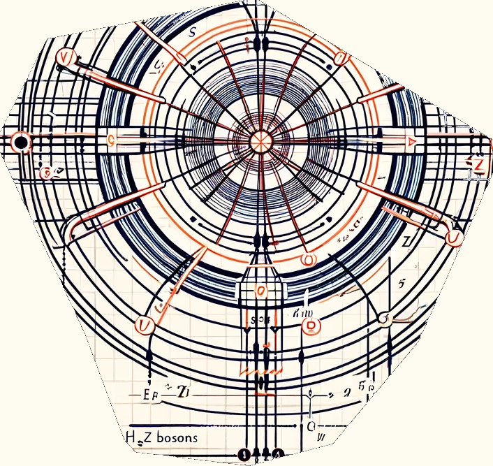

*Engage with Us on [X-Twitter](https://twitter.com/Amaral12358) or [LinkedIn](https://www.linkedin.com/in/marcelo-maciel-amaral-344842162/)*

In the annals of modern physics, the name Abdus Salam evokes a powerful narrative of intellectual brilliance and the pursuit of harmony in the laws of nature. Just as Paul Dirac revolutionized our understanding of quantum mechanics, Salam’s work has stitched together disparate threads of the universe’s fabric, offering a grand tapestry that is as much a testament to human curiosity as it is to the underlying unity of the cosmos.

Early in my career in Rio de Janeiro, I had the opportunity to work closely with Professor Jose Abdalla Helayël-Neto, who himself had worked closely with Abdus Salam during his PhD years in the early 80s at the International School for Advanced Studies in Trieste (SISSA), where he also interacted with Paul Dirac. In this post, I share some of my memories and the insights I gained from Helayël-Neto.

## What is Electroweak Unification?

{fig-alt="Visual tribute to Abdus Salam and electroweak unification"}

The path to Salam’s monumental contribution began with an aspiration towards simplicity and elegance in physical laws, a philosophy that resonated with Dirac’s aesthetic of mathematical intricacy. Salam’s electroweak unification theory, for which he shared the Nobel Prize in 1979, elegantly combined electromagnetism and the weak nuclear force—two of the four fundamental forces in the universe. This synthesis not only deepened our comprehension of particle interactions but also paved the way for the subsequent development of the Standard Model of particle physics.

## A Harmonious Blend of Science and Spirituality

Unlike many of his contemporaries, Abdus Salam navigated the realms of physics and spirituality with equal reverence. As a religious person, he found parallels between the unifying messages of religion and the integrative ethos of his scientific work. His unique approach—merging philosophical thinking and a “science of the word” into the rigorous landscape of physics—championed a view of science that went beyond equations, speaking to the unity of all knowledge.

## From Philosophy to Physics: The Salam Legacy

Helayël Neto, who had the privilege of working alongside Salam, observed that their interactions seldom relied on the conventional tools of mathematics, like blackboards filled with equations. Instead, Salam’s methodology was profoundly discursive, reflective of his belief that the essence of physics could be captured through a narrative language, transcending the confines of mathematical notation. This philosophical stance echoes Salam’s assertion that major innovations in science—akin to the leap from candles to electric lights—stem from basic, exploratory science, not just the perfection of existing technologies.

## The ICTP and a Hub of Collaboration

Salam was also instrumental in establishing the International Centre for Theoretical Physics (ICTP) in Trieste, Italy. It was here that he invited luminaries like Paul Dirac, fostering a nexus of collaboration and dialogue. The ICTP became a testament to Salam’s vision of a scientifically borderless world, where knowledge flows freely irrespective of nationality or creed.

## Dirac’s Influence and Salam’s Quest

There is a profound symmetry in how both Dirac and Salam viewed the elegance of physical laws. While Dirac’s work laid the cornerstone for the edifice of quantum theory, Salam extended the building, incorporating his own blocks of unification. Notably, Dirac’s insights into antimatter provided an essential framework within which Salam’s own theories would later flourish.

## The Unfinished Work of Abdus Salam: Chirality, Unification, and Preons

Abdus Salam’s intellectual pursuits transcended the boundaries of known physics, leaving a legacy characterized by profound inquiries into the universe’s inner workings. His unfinished work on chirality, the Pati-Salam model, and preons encapsulate his ambitious quest to decode the subtext of reality.

In the realm of biology and physics, Salam explored chirality—the distinct ‘handedness’ of biological molecules. His hypothesis that the weak nuclear force could influence molecular chirality suggests a quantum mechanical phenomenon of cooperative behavior, potentially akin to Cooper pairing, which might explain life’s preference for certain chiral forms. This interdisciplinary approach aimed to unite the principles governing the fundamental forces of nature with the origins of life.

Salam’s contributions to unification theory were equally significant. The Pati-Salam model, developed with Jogesh Pati, proposed an SU(4) color symmetry extending the standard quark model to include leptons and posited a universe where left-right symmetry is preserved at higher energies. This model remains unverified but continues to inspire physicists with its predictions of new particles and interactions that could offer a deeper understanding of the cosmos.

Moreover, Salam’s work on preons—conceived as sub-components of quarks and leptons—challenged the Standard Model’s completeness. These hypothetical particles, coming in four varieties, were posited to combine and form the familiar particles of the Standard Model. Despite a lack of direct experimental evidence, the concept of preons persists as a potential key to unlocking the puzzles presented by various anomalies in particle physics.

Salam’s unfinished symphonies in theoretical physics, from the microcosmic chirality to the cosmic dance of unification and the elusive preon particles, beckon future generations to pursue a more profound comprehension of the universe. His vision encourages a continuous search for simplicity beneath the complexity, pointing to an underlying order that connects the cosmos with its fundamental constituents.

## A Legacy of Inspiration and Unification

Abdus Salam’s life and work, steeped in the philosophical and the scientific, remind us that the pursuit of knowledge is not just about understanding the world, but about understanding the myriad ways in which we, as a species, interact with the infinite. His vision of unification transcended the scientific, reaching into the very way we should approach world problems—holistically and inclusively.

As we forge ahead, Salam’s belief in the necessity of basic science for the sake of pure knowledge serves as a guiding star. It challenges us to explore not just for immediate gains, but for the inherent value of knowing, reminding us that today’s esoteric theories could be tomorrow’s technological realities.

## Conclusion

Abdus Salam’s quantum legacy is more than a bridge between cultures, disciplines, and realms of thought—it is a beacon of unification that shines across the fractures of our world. His visionary work reminds us that beneath the vast diversity of the cosmos lies a profound unity, not just within the tapestry of the physical universe, but also within the collective human endeavor to understand it. As we forge ahead in our quest to decipher the code of reality, Salam’s unfinished yet enduring symphonies of theoretical physics continue to resonate, urging us to imagine a future where the harmony that governs the microcosmic world of particles is mirrored in the macrocosmic realm of human collaboration.

For those captivated by the philosophical implications of Salam’s work, or who wish to delve deeper into the impact of his scientific legacy, I invite your engagement. Your inquiries and reflections can fuel ongoing dialogues that embody Salam’s spirit—his relentless pursuit of unity in our understanding of the universe and his dream of a world bound by the elegant principles of symmetry and harmony that he so cherished.

*Engage with Us on [X-Twitter](https://twitter.com/Amaral12358) or [LinkedIn](https://www.linkedin.com/in/marcelo-maciel-amaral-344842162/)*

## References

1. [The Quantum Legacy of Paul Dirac: Spin, Antimatter, and the Evolution of the Scientific Method](../../../../2023/10/07/the-quantum-legacy-of-paul-dirac-spin-antimatter-and-the-evolution-of-the-scientific-method/index.qmd)
2. [Nobel Lectures in Physics (1979) – Abdus Salam](https://www.nobelprize.org/prizes/physics/1979/salam/lecture/)
3. [Electroweak Unification Theory – A Historical Perspective](https://www.annualreviews.org/doi/10.1146/annurev-nucl-102313-025537)
4. [The Role of the International Centre for Theoretical Physics (ICTP) in Fostering Scientific Collaboration](https://www.ictp.it/home/who-we-are)
5. [The role of chirality in the origin of life](https://link.springer.com/article/10.1007/BF02193624)
6. [Lepton number as the fourth “color”](https://web.archive.org/web/20190220013017/http://pdfs.semanticscholar.org/21fb/f9d49acf3e3f07098ca686ae4058c38dbd03.pdf)
