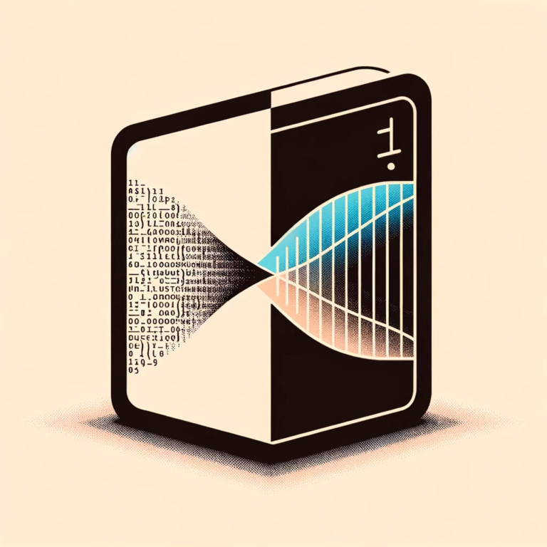

*Engage with me on [X-Twitter](https://twitter.com/Amaral12358) or [LinkedIn](https://www.linkedin.com/in/marcelo-maciel-amaral-344842162/)*

The exploration of code, programming languages, and the concept of ‘programs’ is increasingly intersecting with the realms of quantum gravity and unification theories. A particularly captivating idea within this field is the quest to uncover the underlying ‘code’ of reality, with a focus on the enigmatic Planck scale. This pursuit, rich in complexity and multidimensional motivations, forms the crux of our exploration.

In this essay, our goal is to demystify and illuminate these concepts, not only in their traditional sense within computer science but also in their intriguing parallels across diverse disciplines such as biology and linguistics. We are not just engaging in an academic endeavor; our exploration seeks to unearth profound insights and potential groundbreaking discoveries within the realm of quantum gravity at the Planck scale.

{fig-alt="Illustration of code structures emerging down to microscopic and Planckian scales"}

Our journey will navigate the fascinating intersections between the digital and the fundamental, enhancing our understanding of the universe’s underlying structures. Moreover, we propose extending the principles of open source – a philosophy born in the digital world – to the exploration and understanding of Planck scale codes and languages. This approach represents a bold step towards decoding the deepest mysteries of the cosmos, bridging the gap between computer science and the very fabric of reality.

## The Essence of Code: Programming and Genetic Instructions

Code in Programming: In the realm of digital technology, code is the set of instructions written in a programming language, dictating actions for computers. It is the specific commands crafted by developers, forming the fundamental element that instructs a computer. Picture code as the script of a play, detailing every action and dialogue, intricately guiding the narrative.

Code in Natural Languages: In the context of human languages, ‘code’ can be likened to the basic elements of communication – words, phrases, and sentences. These elements are analogous to the instructions in programming, where they form the building blocks of meaningful expression. In natural language, this ‘code’ encapsulates the rules of grammar, syntax, and semantics, enabling us to construct coherent and effective means of communication.

Code in Biology: In the biological world, this concept is paralleled by DNA and RNA sequences. These genetic structures serve as vital instructions for constructing and regulating life, analogous to how lines of computer code govern digital operations.

## Languages: The Medium of Expression, Bridging Human, Computer, and Genetic Communication

Programming Languages: Tools like Python or Java offer a syntax and a set of rules for coding. Each programming language, with its unique syntax and intended use, acts as a conduit through which developers convey instructions to computers. Similar to human languages with their distinct grammars and vocabularies, programming languages enable the expression of complex computational ideas.

Natural Languages: In human interaction, languages are the essential tools for expressing intricate ideas and weaving stories, serving as the fundamental medium for communication and expression.

Genetic Code: The genetic code in biology, itself, is akin to this concept. It establishes the guidelines for translating the sequences of DNA and RNA into the functional molecules of life – proteins.

## Programs and Genes: Executing Instructions

Programs in Computing: A program is an organized collection of code designed to perform specific tasks. These are the tangible outcomes of coding, manifesting as executable software applications that range from basic utilities to sophisticated systems. Comparable to a play brought to life on stage, programs are the active realizations of their underlying scripts.

Programs in Natural Language: Extending the analogy further, ‘programs’ in natural language can be compared to larger structures of communication such as stories, conversations, or texts. Just as a program in computing is a complex assembly of code designed to achieve a specific task, a well-crafted story or dialogue in natural language is a structured arrangement of words and sentences, designed to convey a message, evoke emotions, or prompt actions. These ‘programs’ in natural language are dynamic and interactive, evolving with the context of the conversation or the narrative flow of the story.

Genes and Proteins in Biology: In a similar vein, genes in DNA hold the blueprints for protein synthesis, operating as nature’s programs. These genetic segments encapsulate instructions that, when expressed, form proteins – the workhorses that drive numerous biological functions.

## Open Source and Genetic Sharing: Pillars of Collaboration and Evolution

Open Source in Software: This concept revolves around code that is accessible and modifiable, fostering innovation in software development. Open source software, exemplified by the Linux operating system and the Python programming language, embodies a model of transparency and communal contribution. This approach allows anyone to view, modify, and distribute the code, thereby enhancing collaboration and creativity within the software development community. While the Python language itself is open source, individual Python programs can vary, being either open or closed source.

Genetic Diversity in Biology: In biology, genetic sharing, as seen in processes like sexual reproduction and horizontal gene transfer, is akin to the principles of open source in software. This natural sharing and mixing of genetic information drive evolutionary innovation and diversity, similar to how open source software evolves through communal contribution and adaptation.

Open Source in Natural Language: Translating this concept to natural languages, open source can be seen in the way languages evolve and adapt through collective usage and interaction. Just as software is improved and diversified through open source contributions, languages develop and enrich through the contributions of their speakers.

## Beyond Computing: A Universal Language of Structure and Function at Our Scale

This analogy extends into other domains, each employing a form of ‘code’ within a ‘language’ to create ‘programs’, and embracing the open-source ethos:

- Music Composition: In music composition, musical notes serve as the ‘code’. They are structured and informed by music theory, the ‘language’ of this domain. The result of this combination is compositions, which can be viewed as ‘programs’ in this context, each a unique creation conforming to the underlying theory yet expressive in its own right.
- Cryptography: Cryptography utilizes encrypted messages as its ‘code’. These messages are shaped and secured by encryption algorithms, which represent the ‘language’ of this field. The outcome of this process is secure communication systems, analogous to ‘programs’, safeguarding information transfer.
- Architecture and Engineering: In these disciplines, design plans are the ‘code’, meticulously following architectural principles, the ‘language’ of structural design. The culmination of these plans is seen in the construction of buildings and structures, the ‘programs’ that stand as physical manifestations of the theoretical underpinnings.
- Cooking and Culinary Arts: Recipes in cooking and culinary arts act as the ‘code’, adhering to the culinary concepts and techniques that form the ‘language’ of gastronomy. The dishes created from these recipes are akin to ‘programs’, each a delightful realization of culinary theory and practice.
- Mathematics: In the realm of mathematics, equations represent the ‘code’. These equations are based on mathematical principles, the foundational ‘language’ of this discipline. From these equations emerge theorems and models, the ‘programs’ of mathematics, illustrating complex concepts and relationships through precise mathematical language.

In each of these domains, the interaction between ‘code’ and ‘language’ results in the creation of ‘programs’—functional, expressive, or theoretical constructs. These examples demonstrate the universality of this metaphorical framework, highlighting the pervasive nature of structured language and functional implementation in various aspects of human creativity and understanding.

**Genetic Code: A Unique Self-Executing System**

Unlike the realms of computer science, natural languages, or the other general analogies we’ve discussed, the genetic code operates as a self-executing system. This distinction is fundamental, setting it apart from the consciously created codes in programming and linguistics.

**Self-Executing Code**: In the realm of genetics, ‘programming’ occurs through natural biological processes. DNA’s encoded information is ‘read’ and ‘executed’ by the cell’s machinery, such as ribosomes, which synthesize proteins. This process is not the product of a conscious coder but rather the result of millions of years of evolution.

**Natural Selection as the ‘Coder’**: If an analogy for a ‘coder’ in genetics were to be made, it would be natural selection and evolutionary processes. These mechanisms determine which genetic codes lead to successful organisms. However, this form of ‘coding’ is indirect, driven by environmental adaptation and random mutations, rather than by a deliberate entity.

**Automated and Self-regulated**: The processes of gene expression are automated and regulated within an organism. They are controlled by a complex interplay of internal and external factors, akin to a self-running program equipped with internal checks and balances.

In contrast, computer science and natural language involve:

**Active Coders**: Conscious entities like programmers and writers actively create code or text, making deliberate decisions.

**Purposeful Creation and Execution**: Programs are crafted for specific objectives and require external execution, just as natural languages are used intentionally for communication.

**Emergence and Autopoiesis in Biological Coding**: Despite the differences highlighted, the concepts of autopoiesis and emergence offer a nuanced understanding of the genetic coding process. Biology often exemplifies processes where individual components, lacking in apparent intelligence or knowledge of the underlying ‘language’, collectively exhibit complex behaviors. This is observed in ant colonies or mycelial networks, where the collective demonstrates attributes akin to rudimentary neural networks.

The idea that such emergent behaviors drive the coding in the evolutionary process of the genetic code is an intriguing and contemporary perspective. This view acknowledges that, while individual biological units may not show overt intelligence, the collective interactions at play can lead to sophisticated outcomes – a principle that resonates with the emergent properties of complex systems in various domains.

## Beyond the Genetic Code: to deep layers of reality

So far, we can summarize that programming languages provide the structural framework, code represents the specific application of this framework, and programs are the coherent and purposeful assembly of code aimed at achieving a particular goal. Open source represents the democratization and communal sharing of this coded knowledge, fostering collective innovation and growth.

Additionally, this framework highlights the notion of ‘active coders’—individuals who consciously create and manipulate code in fields like computer science and linguistics. In contrast, we also encounter ’emergent natural coders’ in systems like biology, where coding processes arise spontaneously and are guided by natural selection and evolutionary mechanisms. This distinction offers a nuanced understanding of coding across different domains and highlights the diverse ways in which information and functionality are encoded and expressed in various systems.

To expand our understanding beyond the genetic code, envisioning language as a ‘space’ serves as a powerful metaphor. This perspective aids in conceptualizing the relationships between language, code, and programs in a novel and enlightening way:

**Language as a Space**: Imagine a language (be it a natural language or a programming language) as a vast landscape or a dimensional space. This space is defined by its rules (syntax, grammar), vocabulary (lexicon, commands), and semantics (meaning, functionality). Just like a physical space, this linguistic space has its own boundaries, regions (different aspects or features of the language), and possibilities for exploration and creation.

**Code as Pathways or Constructions within the Space**: Code can be thought of as pathways, constructions, or structures built within this space. When someone writes code, they are navigating the landscape of the language, choosing specific routes (syntax), and assembling structures (commands and functions) to create something meaningful. These pathways and constructions are guided by the rules of the language space but are uniquely designed by the coder to achieve a specific purpose.

**Programs as Completed Architectures or Ecosystems**: A program, then, is like a completed architecture or a fully realized ecosystem within this language space. It’s an assembly of various pathways and constructions (code) that come together to form a functional and coherent whole. This could be akin to a city with interconnected roads, buildings, and services in a physical space. In a program, the different parts of the code interact and function together to perform complex tasks, much like various elements in an ecosystem or an architectural structure work in unison.

Using this metaphor, the act of programming becomes an act of navigation and construction within the defined but expansive space of a language. Coders are like architects or builders, creating structures (code) that form complex systems (programs) within the possibilities and limits of the language space. Open source, in this analogy, might be akin to a community-shared space where anyone can contribute to, modify, and improve the existing structures and pathways.

This approach allows us to draw parallels between the concepts of programming languages, code, and programs, and their counterparts in physics:

- Energy Landscapes as Languages: In this analogy, energy landscapes in physics, defined by Lagrangians or Hamiltonians, are akin to ‘languages’. These landscapes constitute the theoretical framework or the ‘rules’ that govern the behavior of particles and fields. Analogous to how a programming language defines the syntax and semantics for writing code, these energy landscapes dictate the possible states and dynamics of physical systems.
- Paths in Path Integral Paradigm as Code: The paths considered in the path integral formulation of quantum mechanics can be interpreted as ‘code’. In this approach, every conceivable path that a particle takes between two points contributes to the particle’s overall behavior. Each path, or ‘code’, has an associated action, and the summation of all these paths — integrating over the ‘code’ — determines the probability amplitude for the particle’s behavior. This is comparable to writing specific lines of code within the constraints of a programming language to achieve a particular function or output.
- Physical Behavior as Programs: The resulting physical behavior of the system, emerging from the superposition of all these paths, can be likened to a ‘program’. This behavior is the outcome of the complex interplay of all potential paths, similar to how a computer program’s behavior results from the complex interplay of its constituent code. The physical behavior, or the ‘program’, manifests the underlying principles, or the ‘language’, through specific paths, or ‘codes’.

Regarding the notion of a ‘coder’ in this context, a structure resembling that of the genetic code, characterized by emergent natural coders, appears to be a fitting comparison. This suggests that the ‘coding’ in physics may be more emergent and less directed, akin to how genetic coding is shaped by evolutionary processes and exhibits characteristics similar to emergent rudimentary neural networks.

By extending the metaphor in this manner, we forge a bridge between the abstract concepts of computer science and the tangible realities of physics. This comparison illustrates how fundamental principles, be they related to programming languages or physical laws, establish a space of possibilities. Within this space, specific implementations, whether in the form of code or physical paths, lead to observable outcomes, manifesting as either programs in the digital world or physical behaviors in the realm of physics.

## Conclusion: Open-Sourcing the Uncharted Language of the Universe

In our exploration of theoretical physics, particularly at the Planck scale and within the realms of unification theories, we embark on a quest for a yet-undiscovered ‘unification language.’ This journey transcends academic curiosity, representing our profound endeavor to unearth and comprehend the most elemental principles that orchestrate our universe. Imagine this elusive unification language as the ultimate compendium or source of physical laws—a comprehensive and all-encompassing framework or space that potentially describes every phenomenon, from the tiniest particles to the vastest fields, across the cosmic tapestry. An educated guess can be made at the level of ‘programs,’ which may correspond to known particles and fields at subatomic scales.

The specific ‘codes’ of this language, from which these programs arise, remain as mysterious and uncharted as the language itself. These codes, which we are striving to reveal and understand, are believed to be the blueprints of the universe’s myriad components.

Our ambitious goal is to make these yet-to-be-discovered codes and their unifying language open-source. This initiative echoes the ethos of open-source software, advocating for a collaborative, transparent, and inclusive approach to one of the most profound scientific endeavors of our time. Open-sourcing the fundamental codes of the universe invites a democratized pursuit of its deepest secrets. It is a rallying call for collective intelligence and innovation to unravel these cosmic codes, making the fundamental principles of our cosmos accessible to all and encouraging widespread collaboration in this grand exploration.

This approach not only deepens our understanding of the universe but also empowers us to actively participate in its grand narrative. By striving to decode and share the ultimate language of reality, we take a monumental leap forward—not just in interpreting the universe but in being an integral part of its extraordinary story. It’s a journey that unites us in our shared quest for knowledge and connection with the cosmos, as we seek to illuminate the unseen codes that compose the symphony of existence.

As a final note, it’s important to stress that the inherent assumption of the universality of coding principles, as discussed in this essay, warrants further detailed examination. Additionally, [our specific approach](https://www.preprints.org/manuscript/202111.0359/v2/download) to exploring quasicrystalline geometric languages (tiling spaces) and their unique codes or paths represents another layer of this multifaceted investigation. Delving into these specialized areas not only enriches our understanding but also highlights the complexity and diversity within the broader discourse on coding principles across various disciplines.
