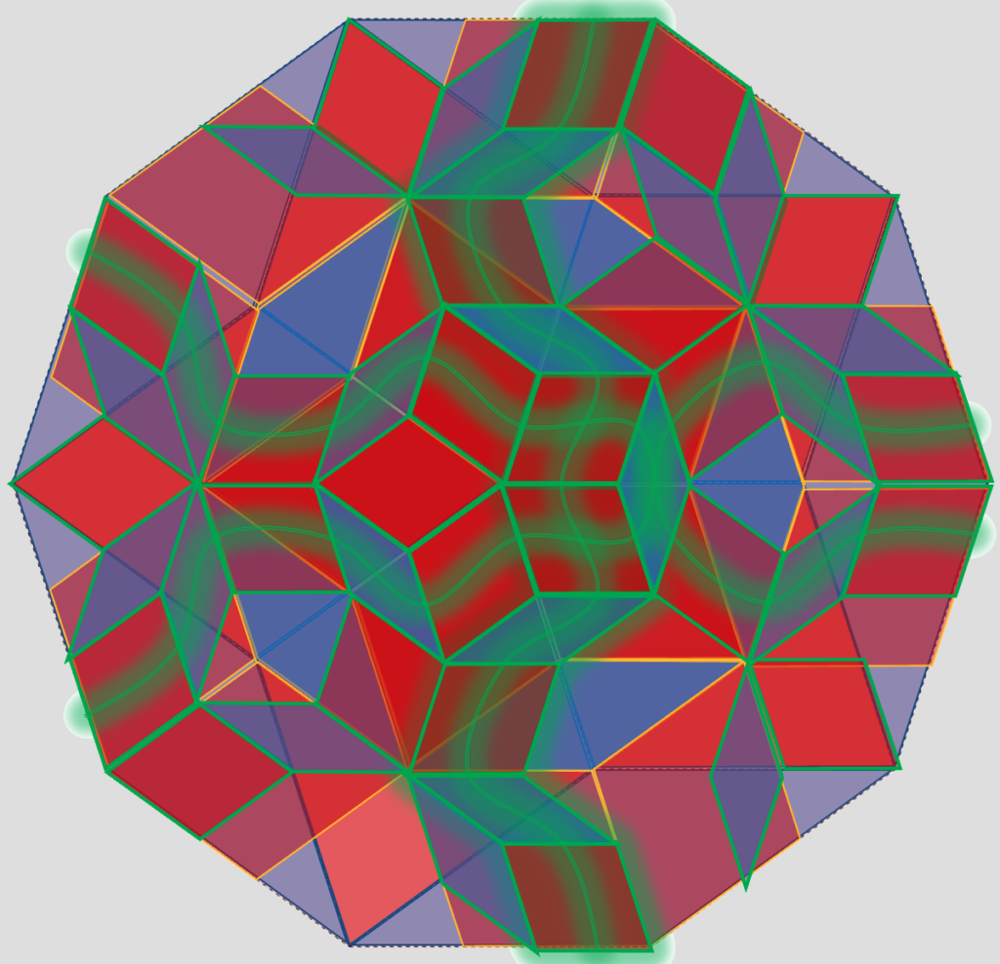
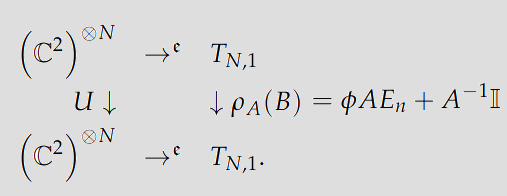
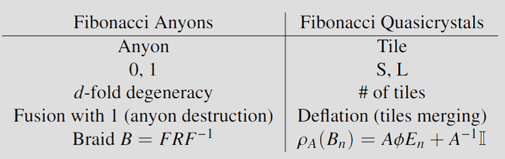

*Engage with Us on [X-Twitter](https://twitter.com/Amaral12358) or [LinkedIn](https://www.linkedin.com/in/marcelo-maciel-amaral-344842162/)*

**Introduction**:

Imagine constructing a building with bricks that don’t perfectly align, yet create an intricate and mesmerizing pattern. This analogy brings us closer to the intriguing world of quasicrystals. Recent advancements, especially the discovery of moiré quasicrystals formed by layering graphene, have not only captivated scientists but also raised an exciting question: Can these materials be the key to unlocking the potential of topological quantum computing?

{fig-alt="Ribbon excitation and phason flip geometry in a cut-and-project quasicrystal"}

---

## What Are Moiré Quasicrystals?

Like the jigsaw puzzle with uniquely shaped pieces that come together to form a cohesive image, moiré quasicrystals are born when layers of graphene are stacked at specific “twist angles.” This results in a fascinating lattice structure without the repetitive symmetry found in traditional crystals. The recent exploration of moiré quasicrystals by researchers at MIT has cast light on their captivating energy-momentum relations and the intricacies of their electronic structures.

---

**The World of Topological Quantum Computing**:

In the realm of quantum computing, imagine a method so advanced and stable that it can revolutionize how we understand and manipulate quantum information. That’s topological quantum computing. At its core are anyons, quasiparticles with unique properties. But turning the theoretical potential of TQC into practical applications has been like solving a complex puzzle, with many pieces yet to fit.

---

**Bridging Two Worlds: Quasicrystals and TQC**:

Our recent research uncovers a deep connection between the Hilbert spaces of anyonic systems and quasicrystals. Consider the “projection Eₙ” operations in quasicrystals as analogous to anyonic operations like braid gates. This insight suggests that techniques originally developed for anyons, especially those in the context of universal quantum computing with Fibonacci anyons, could find parallels in the domain of Fibonacci quasicrystals.

{fig-alt="Schematic mapping topological quantum computing concepts onto quasicrystals"}

---

**Unpacking Our Research**:

Here’s a simplified breakdown of our findings on how quasicrystals can harness anyonic behavior for topological quantum computing:

- Quasicrystals, with their unique non-repetitive structures, can be visualized as intricate patterns created from higher-dimensional lattices.
- The fusion spaces of Fibonacci anyons and Hilbert spaces of Fibonacci quasicrystals both expand following the Fibonacci sequence, hinting at their interconnectedness.
- This connection allows for a seamless transition between the fusion algebras of Fibonacci anyons and the algebras of Fibonacci quasicrystal tiling spaces.
- The projection operations Eₙ in quasicrystals act similarly to braid operations in anyons, manipulating the quasicrystal spaces and hinting at their potential in topological quantum computing.

{fig-alt="Comparison diagram between Fibonacci anyon fusion trees and Fibonacci quasicrystal configurations"}

---

**Discoveries from MIT**:

A breakthrough from MIT researchers has added a fascinating chapter to our understanding of moiré quasicrystals:

- By strategically twisting three layers of graphene, they birthed a new kind of moiré material showcasing a quasicrystal pattern.
- These quasicrystals bridge the gap between regular crystals and amorphous materials, with much of their properties still shrouded in mystery.
- Not only does this moiré quasicrystal serve as a platform for studying phenomena like superconductivity, but it also provides a simpler and more flexible method for creating and controlling quasicrystals.

---

**Concluding Thoughts**:

As we stand on the cusp of new scientific horizons, the symbiotic relationship between moiré quasicrystals and topological quantum computing hints at a future filled with untapped potential. As researchers, our quest is to decode these mysteries and pave the way for innovations that were once the stuff of science fiction.

---

**Further Reading**:

For those eager to delve deeper, links to the full research papers and other relevant resources are provided below:

- [Paper: Exploiting Anyonic Behavior of Quasicrystals for Topological Quantum Computing](https://www.mdpi.com/2073-8994/14/9/1780)
- [Paper: Superconductivity and strong interactions in a tunable moiré quasicrystal](https://www.nature.com/articles/s41586-023-06294-z)
- [Topological Quantum Computing](https://ncatlab.org/nlab/show/topological+quantum+computation)

---

*Engage with Us on [X-Twitter](https://twitter.com/Amaral12358) or [LinkedIn](https://www.linkedin.com/in/marcelo-maciel-amaral-344842162/)*
