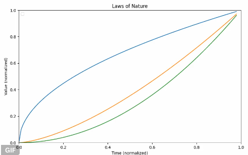

## Introduction

In our current materialistic and scientific worldview, we often focus on the laws of nature or laws of physics. We conduct experiments and observations, infer principles, and develop theories that can be used to make predictions. When these predictions are confirmed, the underlying principles are reinforced. However, what we consider as laws today were not recognized as such a hundred years ago. As our knowledge advances, we must update our theories and principles. This can be seen as the evolution of our understanding or as the evolution of reality itself. The Planck scale is expected to be a scale where the current laws break down. The concept of the Planck scale traces back to Max Planck himself.

*Engage with Us on [X-Twitter](https://twitter.com/Amaral12358) or [LinkedIn](https://www.linkedin.com/in/marcelo-maciel-amaral-344842162/)*

{fig-alt="Conceptual Laws of Nature plot showing evolving normalized trajectories over time"}

To illustrate the significance of the Planck scale, consider the Planck temperature, which is an incredibly high temperature that represents a fundamental limit in our understanding of physics. If a piece of metal could be heated to the Planck temperature, it would instantaneously vaporize into a burst of pure energy before the heat could even begin to spread through the object. This temperature is about 1.42×10³² Kelvin (or about 100 million trillion trillion degrees Celsius).

For context:

- The hottest temperature ever created in a laboratory is about 5.5 trillion degrees Celsius.
- The core of the Sun is only about 15 million degrees Celsius.

At the Planck temperature, our current understanding of physics breaks down. It is theorized that at this extreme, the fundamental forces of nature (gravity, electromagnetism, strong nuclear force, and weak nuclear force) might unify into a single, all-encompassing force.

Max Planck, often regarded as the father of quantum theory, made groundbreaking contributions that forever changed the landscape of physics. His work at the turn of the 20th century introduced the concept of quantized energy levels and led to the establishment of the Planck scale, which serves as a bridge between quantum mechanics and general relativity. This article explores Planck’s derivation of the Planck scale, his introduction of quantum theory, and the profound implications for modern physics.

## Note for the Full Series

Here we begin the first article in the series “Planck Scale Pioneers,” starting with the context around 1900 and the concept of this profound scale of reality. But what is the big deal about this? If you ask a large language model (LLM) about it, you’ll get an informative answer, and if you ask again, you’ll get a slightly different one, and so on. Even before LLMs, you could search Google and find many articles on the subject. However, the value lies not merely in the presentation of facts but in the nuanced exploration of lesser-known, deeper questions that arise at the frontiers of our understanding.

So, why would one ask the question in the first place? This is why scientists need more direct communication to bring awareness to these lesser-known deep questions. That’s exactly why I’m here—to not only inform but to add value and awareness. Please let me know if I succeed or fail, as I can adjust the style for the upcoming articles in this series.

## The Historical Context

To understand the emergence of the Planck scale idea, we need to look back at the late 19th century. During this period, physics was dominated by classical theories that successfully explained macroscopic phenomena but struggled with anomalies at microscopic levels. One such anomaly was the blackbody radiation problem. Classical theories predicted an ultraviolet catastrophe, where an infinite amount of energy would be radiated at short wavelengths. This prediction, however, was in stark contradiction to experimental observations. Interestingly, we see this kind of catastrophe in our current dominant theories as well – singularities at extremes. Just as the ultraviolet catastrophe pointed to the limitations of classical physics, these modern singularities may be indicators of where our current theories break down, potentially at the Planck scale.

## Planck’s Breakthrough

Max Planck sought to resolve this discrepancy. In 1900, he proposed a radical idea: energy is quantized and can be emitted or absorbed only in discrete amounts called “quanta.” Planck introduced a new constant, now known as Planck’s constant (h), to describe these energy quanta. His formula for the energy of a quantum is

$$E = h\nu$$

where v is the frequency of the radiation.

## Derivation of the Planck Scale

In 1899, one year before the emergence of quantum theory, Max Planck introduced a new constant that would later bear his name: the Planck constant. In his obscure paper, Planck also proposed a set of base units for length, mass, time, and temperature, which were eventually named after him. These units, now known as Planck units, are derived from fundamental constants and are foundational in the realm of theoretical physics. Planck highlighted the universal applicability of these units, stating that they are independent of any specific objects or substances and retain their significance across all cultures and epochs, even beyond Earth. In his words,

> Units of length, mass, time, temperature can be established, which, independently of specific bodies and substances, would necessarily have significance for all times and cultures, even extraterrestrial and non-human ones, units that can therefore be designated as natural units of measure.

The first attempts to establish fundamental units date back to the late 19th century, amidst the flourishing of dimensional analysis. The idea of a fundamental length, today, is based on much more than mere dimensional arguments. However, many current defenses of it—such as in quantum gravity—still use aspects of this nature as the core of their arguments. Therefore, it is interesting to start our presentation with discussions related to dimensional analysis.

Dimensional analysis emerged in the second half of the 18th century but was only widely disseminated a century later. The important French mathematician Joseph Bertrand wrote in 1878:

> The unit of length, the unit of time, and the unit of force are arbitrary and independent; but once we choose them, all others are interconnected (…)

Contrary to this idea that units are arbitrary, the Irish physicist George Stoney proposed the existence of preferential units, which he called natural units. Stoney’s proposal went largely unnoticed until Max Planck advocated for it (possibly without knowing Stoney’s work).

In his works from the late 19th century, Planck conjectured several new fundamental constants. The most famous is his constant h, proposed in 1900. Another less known is the constant b, proposed in 1899. From this quantity b, he defined certain units, which he called natural units of measure:

$$l_p = \sqrt{b G / c^3} \approx 4.13 \times 10^{-33}\text{ cm}$$

Where:

- lp is the Planck length
- b is Planck’s constant (later refined to h)
- G is the gravitational constant
- c is the speed of light in vacuum

This formulation laid the groundwork for what we now know as the Planck scale, a set of physical units that help us understand the limits of our current physical theories and point towards a unified theory of quantum gravity.

Today, the Planck length (lp), Planck time (tp), and Planck mass (mp) are defined as follows:

$$
\begin{aligned}
l_P &= \sqrt{\frac{\hbar G}{c^3}} \approx 1.616 \times 10^{-35}\text{ meters} \\
t_P &= \sqrt{\frac{\hbar G}{c^5}} \approx 5.391 \times 10^{-44}\text{ seconds} \\
m_P &= \sqrt{\frac{\hbar c}{G}} \approx 2.176 \times 10^{-8}\text{ kg}
\end{aligned}
$$

where

ℏ=h/2π

According to Planck, these quantities established a new standard of unit that, in contrast to the arbitrariness of conventional measurement systems, was universal. The universality of this new system of units was, for Planck, a reflection of the universality of black body radiation. Thus, the idea of a fundamental length emerged.

## Implications of the Planck Scale

The Planck scale represents the limits of our current understanding of physics. At these scales:

1. Quantum effects become as significant as gravitational effects.
2. The concept of space and time as continuous entities breaks down.
3. Our current theories of physics (quantum mechanics and general relativity) are no longer compatible.

For example, at the Planck scale, the smooth, continuous spacetime described by general relativity breaks down due to quantum fluctuations. Additionally, the Heisenberg Uncertainty Principle, a cornerstone of quantum mechanics, faces challenges at the Planck scale. Both smooth spacetime and the uncertainty principle (two of the current laws of physics) cannot fundamentally hold true at this scale.

To illustrate this, consider the following argument:

The Heisenberg Uncertainty Principle states that the product of the uncertainties in position (Δx) and momentum (Δp) must be greater than or equal to a small constant (Planck’s constant divided by 2). At the Planck scale, attempting to measure position with Planck length precision results in a very small Δx, approximately the Planck length. Consequently, the uncertainty in momentum Δp becomes very large.

When we calculate the energy associated with this large momentum uncertainty, it turns out to be extremely high, on the order of the Planck mass energy. This amount of energy in such a small volume would theoretically create a black hole with a Schwarzschild radius larger than the Planck length.

This paradox suggests that either the Uncertainty Principle needs modification at the Planck scale, or our concepts of space and time need revision at this scale. These inconsistencies highlight the necessity for a new theory that can integrate quantum mechanics and general relativity, providing a more comprehensive understanding of the universe at its most fundamental level.

## Why the Planck Scale Matters to Us Today

Planck’s work laid the foundation for numerous developments in physics, which continue to influence and drive modern scientific research.

1. **Einstein’s Explanation of the Photoelectric Effect:** Planck’s quantization of energy provided the basis for Einstein’s theory, which explained how light can eject electrons from a material. This discovery was pivotal in the development of quantum theory.
2. **Bohr’s Model of the Atom:** Planck’s ideas about quantized energy levels influenced Niels Bohr’s model, which described electrons orbiting the nucleus in discrete energy levels. This model is fundamental to our understanding of atomic structure.
3. **The Development of Quantum Mechanics:** Planck’s introduction of energy quanta was a crucial step towards the formulation of quantum mechanics, which describes the behavior of particles at the smallest scales. Quantum mechanics has led to numerous technological advancements, including semiconductors and lasers.
4. **Attempts at Quantum Gravity:** Planck’s work on fundamental units has inspired theories like string theory and loop quantum gravity, which attempt to unify quantum mechanics and general relativity. These theories aim to provide a more comprehensive understanding of the universe.

Ongoing Research and Open Questions

While Planck’s contributions have revolutionized physics, many fundamental questions remain unresolved:

1. **Reconciling Quantum Mechanics and General Relativity:** One of the greatest challenges in theoretical physics is finding a theory that unifies these two pillars of modern physics. The Planck scale is expected to be the key to this unification.
2. **Phenomena at the Planck Scale:** Understanding what happens at the Planck scale could reveal new aspects of the fundamental nature of reality. This scale represents the limits of our current theories and could provide insights into the workings of the universe at its most basic level.
3. **Quantization of Space-Time:** Investigating how space-time might be quantized could lead to new insights into the structure of the universe. This could fundamentally change our understanding of space, time, and gravity.
4. **Extending Existing Theories:** Developing new theoretical frameworks to address the inconsistencies and paradoxes observed at the Planck scale is a key area of ongoing research. This could involve modifying or extending current theories to create a more complete picture of the universe.
5. **Is There Life at or Beyond the Planck Scale?**: While this question might seem speculative, it prompts us to consider the unknown possibilities at these extreme scales. The vast gap between subatomic scales and the Planck scale represents a significant frontier in our understanding. Even with the speed of light limit, we can observe the large-scale universe with our telescopes, but the scales below the subatomic level remain hidden from us. This “desert” of scales, spanning many orders of magnitude, highlights our current ignorance and drives the quest for new knowledge.

## Conclusion

The implications of the Planck scale are profound, influencing both theoretical physics and practical applications. By continuing to explore and understand this fundamental scale, we can gain deeper insights into the nature of reality, potentially leading to groundbreaking discoveries and technologies. Planck’s pioneering work remains as relevant today as it was over a century ago, driving forward our quest to understand the universe at its most fundamental level. The desert is vast from where we can see to the Planck scale, but so is the possibility of roads to be built to go there. Anyone can join this pioneering adventure, contributing to our collective journey towards understanding the deepest mysteries of the universe.

*Engage with Us on [X-Twitter](https://twitter.com/Amaral12358) or [LinkedIn](https://www.linkedin.com/in/marcelo-maciel-amaral-344842162/)*
