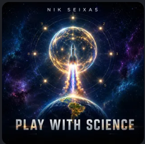

{width="320px" fig-alt="Cover artwork for the album Play with Science released with Nik Seixas"}

I just finished producing a new album, “Play with Science,” released with [Nik Seixas](http://nikseixas.com).

It feels slightly unusual to post music here, but the way this record became possible is closely related to something I think matters professionally and socially: technological progress can remove bottlenecks that keep human potential unrealized.

I started writing some of these lyrics when I was young in Brazil, including during my university years. I grew up listening to artists such as The Beatles, Bob Marley, Raul Seixas and Brazilian rock from the 1980s — music in which an acoustic guitar, a melody and meaningful words could already carry a world.

Writing songs was possible.

Producing them was another matter.

A real recording project required musicians, rehearsals, arrangements, studio time, engineering, money, coordination and, perhaps most difficult of all, enough uninterrupted time and energy to make all of those pieces come together.

So many ideas simply remained potential in local voice and acoustic guitar.

More than twenty years later, generative AI changed that constraint.

AI became part of the production environment that allowed old lyrics, new compositions, family recordings and years of accumulated ideas to become a finished nine-track album.

That experience has made me think about a much larger question:

How much human potential is currently trapped behind bottlenecks?

Someone may have a book but no publisher.

A researcher may have an experiment but not the people or computational resources to explore it.

A student may have an idea but lack the technical skills to prototype it.

An entrepreneur may understand a problem intimately but be unable to afford the team required to test a solution.

A musician may have twenty years of songs sitting in notebooks.

AI will certainly create difficult questions about work, concentration of power, authenticity and economic transition. But there is another possibility worth actively building toward: dramatically increasing the number of people who can turn intention into action.

More access can mean more experiments attempted.  
More ideas expressed.  
More problems explored.  
More people able to participate.

To me, one of the important challenges is therefore not only making AI more capable. It is figuring out how to distribute those capabilities widely enough that technological abundance becomes human opportunity.

Can we use these systems to unlock lives constrained by money, geography, education, time or circumstance?

Can some of this new abundance help us optimize a little more for love, opportunity and human flourishing — and reduce some unnecessary suffering?

“Play with Science” is only a small creative example.

But for me it turned something that had remained potential for decades into something real.

🎧 [nikseixas.com/playwithscience](http://nikseixas.com/playwithscience)
