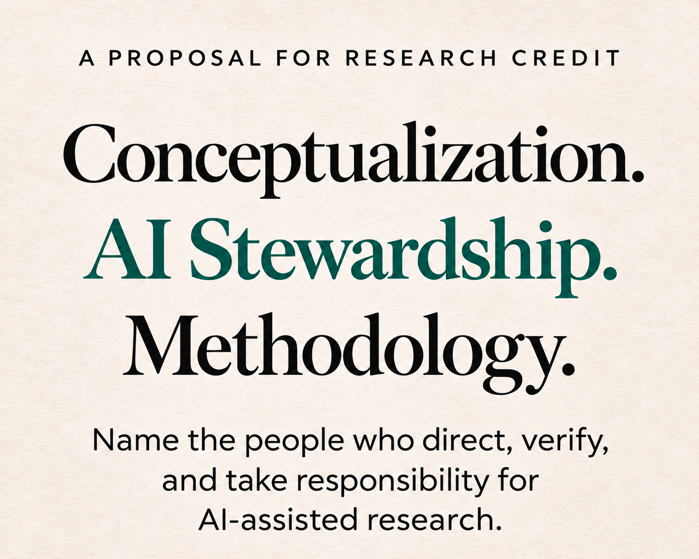

**Conceptualization. AI Stewardship. Methodology.**

I want to see those three terms together in research papers. Directing and checking AI-assisted work can be a substantive research contribution. We should name and credit it.

{fig-alt="Editorial graphic on a cream background, headed “A proposal for research credit.” Three large lines read “Conceptualization. AI Stewardship. Methodology.” AI Stewardship is highlighted in teal. Below: “Name the people who direct, verify, and take responsibility for AI-assisted research.”" width=640}

When AI systems write code, analyze data, or explore an argument, the model’s name tells readers which system was used. It leaves open who designed the assignments, checked the results, resolved disagreements, and decided what the paper could claim. A researcher who identifies an unsupported assumption and helps narrow a claim has shaped the paper, even if readers never see the version that was rejected.

I use **AI Stewardship** to mean directing how AI is used in a research project, establishing and evaluating the checks on its outputs, and taking responsibility for what is retained. That includes recognizing where verification remains incomplete and limiting the claims accordingly.

In my [earlier essay on education](https://www.gaugefreedom.com/stewardship-of-ai-the-missing-standard-in-education/), I argued for evaluating what students understood, checked, and could defend. The [Intelexta stewardship page](https://www.intelexta.com/ai-stewardship/) connects that argument to a workflow for documenting the checks. Here I want to extend that argument to research credit: name the people who did the work.

## Why name the contribution?

Parts of this work already overlap with Methodology, Validation, and Supervision. Naming **AI Stewardship** makes explicit who determined how AI would enter the research, how its outputs would be assessed, and what evidence was sufficient to use them.

The credit should follow the work, whether carried out by a lead researcher, a student, or a collaborator. Stewardship can be shared. A contribution statement should identify the people who designed the assignments, performed the checks, and made the decisions about what to retain.

## What does AI Stewardship look like?

In mathematics, it might mean arranging a separate derivation before comparison with a proposed proof, examining the assumptions, and recording any steps that remain unresolved.

In a simulation study, it might mean preserving the code and configuration, arranging a rerun, and checking the result against a benchmark or limiting case.

In qualitative research, it might mean defining what material an AI tool may access and checking its suggested interpretations against the original interviews.

The checks vary by field. A useful record shows what each check established and what remains unresolved. The contribution statement should describe the steward’s work concretely.

## How to credit it

Where the publication permits additional roles, put **AI Stewardship** directly in the contribution list. For example:

> **Author Contributions:** Conceptualization, M. M. A.; AI Stewardship, M. M. A.; Methodology, M. M. A.

Then give the reader a sentence of substance, adapted to the work actually performed:

> **AI Stewardship:** M. M. A. scoped the AI-assisted analyses, established the checking criteria, reviewed the supporting evidence, and documented decisions to retain, revise, or reject outputs.

Where several people carried out that work, name them and specify their contributions.

AI Stewardship is a proposed role; it is not currently among [CRediT’s 14 contributor roles](https://credit.niso.org/contributor-roles-defined/). Where a journal requires that taxonomy, use the applicable roles and describe the stewardship work in prose where permitted. Follow the journal’s AI disclosure policy as well.

## Describe the AI’s work, too

An accompanying account of AI-assisted contributions should identify the systems and versions used and the tasks they performed. In a workflow involving several agents, one might coordinate review assignments, another write code, and another search for counterexamples. Describe those activities and connect them to the resulting artifacts and checks.

That gives readers a more useful account of the research: what the systems contributed, what the researchers did, and how the work was assessed.

When decisions about AI shape the methods, evidence, and claims of a paper, the people responsible for those decisions have made a research contribution. **AI Stewardship** gives that contribution a name.
