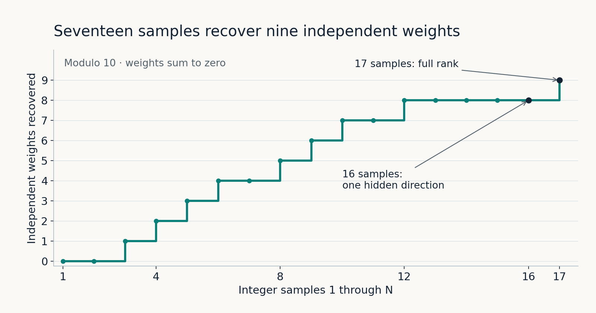

**Sixteen samples leave a hidden pattern. The seventeenth reveals it.**

In my new [Gauge Freedom Field Note](https://doi.org/10.65323/gf-lab.2026.004), the first seventeen samples of a weighted sum over prime powers recover all nine independent weights in a finite model. A particular degree-five correspondence between Tate curves sees only one combination. Among the patterns it misses is a sign that the Fibonacci tiling rule can read, one prime at a time.

This is one part of a research direction connecting aperiodic order, adelic arithmetic, and the Riemann Hypothesis. Three preprints now describe the finite construction, its geometric background, and the statistical mechanics of prime powers. The independent cancellation estimate linking this program to a critical-line proof remains open.

## What seventeen samples recover

Assign a real weight to each residue class modulo ten and require the ten weights to sum to zero. That leaves nine independent choices. A prime power $p^k$ contributes its residue-class weight, multiplied by $\log p$ and a ramp that switches on when the observation scale exceeds $p^k$.

The first sixteen integer samples cannot distinguish every possible assignment. For example, put weight $+1$ on residue six, weight $-1$ on residue zero, and zero elsewhere. All sixteen samples vanish. The first prime power in residue six is $16$, and at sample $17$ it contributes $\log(2)/16$. Together, samples one through seventeen determine every allowed weight.

{fig-alt="Finite recovery of degree-zero weights modulo ten: the first sixteen prime-power ramp samples have rank eight; the first seventeen have full rank nine." width=780}

This is an exact finite reconstruction result. It tells us which information the samples contain.

## Reading a sign through Fibonacci geometry

The Fibonacci inflation matrix has characteristic polynomial $t^2-t-1$. For a prime $p$, count the lines it preserves over $\mathbb{F}_p$ and subtract one: the result is $\chi_5(p)$, the quadratic character modulo five.

| Prime | Invariant lines | Character value |
|:---:|:---:|:---:|
| $7$ | $0$ | $-1$ |
| $11$ | $2$ | $+1$ |

The marked Tate correspondence studied in the paper behaves differently. Its transpose has rank one on the nine-dimensional space of weights and sends this quadratic character to zero. The finite ramp and Fibonacci calculation can therefore detect arithmetic information that this particular transpose loses.

The distinction is specific to the constructions and markings in the paper. It does not rule out other ways of connecting arithmetic and geometry.

## Where the Riemann Hypothesis enters

Following [Levent Alpöge's announcement of a proof developed with Claude](https://alpo.ge/remark.pdf), we reconstructed selected parts of the released argument. The new Field Note uses its external integral window theorem to relate an arithmetic bound to the zeros of the Riemann zeta function and the quadratic Dirichlet $L$-function of conductor five.

Theorem 6 concerns a fourth-moment bound on the positive part of a specified arithmetic approximation. The samples lie at integer fourth powers and at both endpoints of intervals $[Y,Y^{3/2}]$. The requirement is to find such intervals arbitrarily far out, with a bound uniform over their dyadic blocks.

For each $0<\eta<1/2$, this condition is equivalent to every nontrivial zero $\rho$ of either function satisfying

$$
\left|\operatorname{Re}\rho-\frac12\right|\leq\eta.
$$

As the permitted losses $\eta$ tend to zero, the strips narrow to the critical line.

**An independent Riemann Hypothesis proof through this program still requires an independent proof of the cancellation estimate.** Fibonacci geometry supplies coefficients prime by prime. The unresolved question is whether their signed, centered contributions cancel sufficiently across a whole window. The seventeen-sample result does not settle that question.

## Two companion studies

[**Fibonacci Cut-and-Project Interval Partitions: Geometry, Entropy, and Shell Estimates**](https://doi.org/10.5281/zenodo.24457170) develops the geometry behind the Fibonacci construction. Varying a window changes the frequencies of finite patches; the paper bounds the resulting partitions, their entropy, and their behavior near the window endpoints.

[**Critical Scaling and the Levy Correction Field of the Zeta Gibbs Sector**](https://doi.org/10.5281/zenodo.24457284) studies a probability distribution built from $n^{-\beta}/\zeta(\beta)$ for $\beta>1$. Near $\beta=1$, it separates universal scaling from a correction field carrying the classical zero-sensitive terms. That separation helps identify where information about the zeros actually resides.

Both are Zenodo preprints dated November 23, 2026. The Field Note is also a research preprint, not an externally peer-reviewed journal article.

## Research credit and the next question

This work grew over months of exploration, encouraged by discussions with Michael Rios and Raymond Aschheim. I directed the research and retain responsibility for the manuscript and its publication. AI systems carried out most of the formal analysis, coding, validation, and first drafting, as documented in the paper's contribution statement.

Our working repository served as a record of calculations, failed approaches, and corrections that later reviews could examine. This is also the kind of work I describe in [AI Stewardship Belongs in Author Contribution Statements](../../22/ai-stewardship-author-contributions/index.qmd).

The next question is precise: can we prove the required cancellation independently? The finite calculations and the analytic criterion tell us what must be controlled. Establishing that control is the remaining mathematical task.

Explore the [Riemann Hypothesis research direction](../../../../research/riemann-hypothesis/index.qmd), read the [Field Note and its reproducibility supplement](https://www.gaugefreedom.com/prime-power-ramps-on-adelic-windows-and-the-degree-five-tate-correspondence/), or find all three records in the [publications bibliography](../../../../publications/index.qmd).
