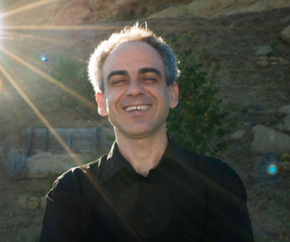
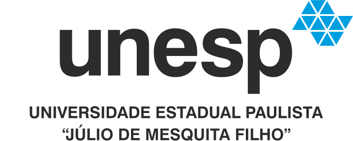
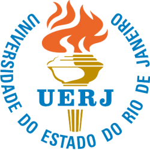

{width="260px" fig-alt="Portrait of Marcelo Maciel Amaral"}

I was born in the mountains of Minas Gerais, Brazil, and raised in Itatiaia, in the mountains of Rio de Janeiro. My early scientific knowledge was gifted to me by my parents and godfather, despite their lack of formal education. Rooted in Christian Catholic values, my spirituality was greatly influenced by the teachings of my grandmother, Iracema, a devoted follower of Nhá Chica.

Today, my research is primarily rooted in exploring the unification of (loop) quantum gravity and the Standard Model of particle physics through the interconnections between lattice gauge theory, topological quantum computing, quasicrystals, and spin foams. My goal is to open-source the "code" of reality, a pursuit that aims to unveil the foundational codes governing the universe. This fascination is a natural progression from my Ph.D. work in physics, where I explored an advanced aspect of the confinement problem in gauge theories using the superfield formalism. My publications during this period provide a rigorous exploration of these themes, which continue to fuel my current projects. But to understand how I reached this point, we have to travel back to my early academic journey.

## Engineering, Optics & Early Computing (UNESP)

In 1996, I began my undergraduate studies in Electrical Engineering at São Paulo State University (UNESP). Access to the university's laboratories exposed me to the internet and Unix/Linux systems early on. I chose to specialize in Computer Engineering, learning algorithms and programming languages such as C, C++, Fortran, and Pascal. My final project, *inteliquestion*, was a precursor to education technology, offering a platform for teachers to prepare tests and students to practice.

{width="260px" fig-alt="UNESP — Universidade Estadual Paulista logo"}

As a student on a scientific initiation scholarship under the supervision of Edgard Dias Batista Jr., I made significant contributions to the ARSIG-2 project. We developed algorithms to gain a better understanding of urban travel patterns, allowing for future predictions and providing solutions to urban planning issues.

In the early 2000s, I completed my master's degree in physics under Carlos Renato Zacharias. Together, we implemented cellular automata codes to explain homeopathic dynamisation or potentisation processes. However, my final thesis was on the application of optimization methods to human eye optics and the development of ophthalmic lenses.

## Open-Source Culture & Software Engineering (i-Motirõ)

Between the early 2000s and early 2010s, I was part of the **i-Motirõ** collective and helped establish the i-Motirõ non-profit association. Since 2005, the collective has worked on digital culture, technological re-appropriation, digital inclusion, open-source software, electronic art, and media education in Rio de Janeiro and Espírito Santo.

{width="200px" fig-alt="i-Motirõ open-source digital culture collective logo"}

In 2005, we managed **IP:// (Public Interface)**, a self-managed space focused on free technology research. We provided technical support and training in digital tools based on free software and collaborated with Circo Voador's Digital Culture Point, operating as Circo Digital. In 2009, we formalized the i-Motirõ collective, emphasizing open-source technologies, digital culture, and electronic art.

Our work included research, technical consulting, and partnerships with institutions such as the Rio de Janeiro State Culture Secretariat and SESC-RJ.

During my academic pursuits, I also worked in the industry, developing software, particularly websites and platforms, for various companies. I contributed to VTEX's CRM, and at Tecnopop and Instituto Overmundo, I helped develop and maintain the collaborative website *Overmundo*, which focuses on Brazilian culture and the culture produced by Brazilians around the world.

## Theoretical Physics & Quantum Gravity

On the research front, I continued my studies in theoretical physics with courses on quantum field theory at the Brazilian Center for Physical Research (CBPF) with Professor José A. Helayël-Neto.

{width="150px" fig-alt="UERJ — Universidade do Estado do Rio de Janeiro logo"}

In 2011, I began my Ph.D. at Rio de Janeiro State University (UERJ) with advisor Vitor E. R. Lemes, concluding in 2015 with a thesis on a supersymmetric extension of the Gribov problem in the superfield formalism. I published supporting papers in scientific journals along the way. In 2015, I received a fellowship from the Brazilian program *Science without Borders* to complete a postdoc at Penn State University, which resulted in work on the problem of time in quantum gravity. Since then, I have collaborated and worked with the [Quantum Gravity Research](https://quantumgravityresearch.org/) group in Los Angeles.

{width="420px" fig-alt="Quantum Gravity Research institute logo"}

::: {.video-container}
<iframe loading="lazy" title="Meet Our Scientists - Marcelo Amaral (Quantum Gravity Research)" src="https://www.youtube.com/embed/lVFPlUpNRr8" allow="accelerometer; autoplay; clipboard-write; encrypted-media; gyroscope; picture-in-picture; web-share" referrerpolicy="strict-origin-when-cross-origin" allowfullscreen></iframe>
:::

## Current Academic, Corporate & Editorial Work

In 2024, I joined Irwin Naturals as Data Analytics Lead, continuing my work at the intersection of computation, data, and scientific research. In 2025, I co-founded [Gauge Freedom, Inc.](../venture/index.qmd), a California benefit corporation dedicated to connecting fundamental research with useful computational technologies and verifiable AI systems.

In 2026, I began postdoctoral research at [Scripps College](https://www.scrippscollege.edu/), working with [Professor Sarah Marzen](https://www.sarahmarzen.com/) on memory, prediction, and energy efficiency in neural systems. This research contributes to the broader [Hybrid-AI collaboration](https://hybrid-ai.umd.edu/), which investigates hybrid artificial–living neural networks for learning and prediction.

I also serve as Co-Editor-in-Chief of [Gauge Freedom Journal](https://www.gaugefreedom.org/), an open-science journal focused on physics, mathematics, AI, quantum technologies, and verifiable research.

My [publications](../publications/index.qmd) and [research](../research/index.qmd) demonstrate my multidisciplinary background.

> "She said the mystery of life isn't a problem to solve, but a reality to experience. So I quoted the First Law of Mentat at her: 'A process cannot be understood by stopping it. Understanding must move with the flow of the process, must join it and flow with it.'"
>
> — Herbert, Frank. *Dune*
