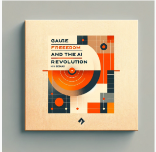

Bridging science, AI, and creativity—exploring quantum physics, artificial intelligence, and music innovation.

## Music Producer

### *Play with Science* (with Nik Seixas, 2026)

[{width="280px" fig-alt="Album cover for Play with Science with Nik Seixas"}](http://nikseixas.com/playwithscience)

A nine-track album produced with [Nik Seixas](http://nikseixas.com), bringing decades of acoustic guitar compositions, lyrics written since university years in Brazil, and AI-assisted studio production into finished form. Read the story behind the album in [Play with Science: A New Nik Seixas Album Made with Human + AI Creativity](../2026/09/21/play-with-science-nik-seixas/index.qmd).

- Listen: [nikseixas.com/playwithscience](http://nikseixas.com/playwithscience)

### *Gauge Freedom and the AI Revolution*

[{width="280px" fig-alt="Album cover for Gauge Freedom and the AI Revolution"}](https://artists.landr.com/064837895833)

- Listen via LANDR: [artists.landr.com/064837895833](https://artists.landr.com/064837895833)

### *A Vida Segue Seu Caminho!*

[{width="280px" fig-alt="Album cover for A Vida Segue Seu Caminho"}](https://artists.landr.com/055855498410)

- Listen via LANDR: [artists.landr.com/055855498410](https://artists.landr.com/055855498410)

## Books

### *Parentalidade com Propósito: Tecendo Sabedoria Prática com Reflexões Pessoais (Abrindo os códigos fontes da realidade)*

[{width="280px" fig-alt="Book cover for Parentalidade com Propósito"}](https://www.amazon.com.br/Parentalidade-com-Prop%C3%B3sito-Sabedoria-Reflex%C3%B5es-ebook/dp/B0CZH6SJWH/)

See also the dedicated [Books](../books/index.qmd) page.

- Portuguese Kindle Edition: [Amazon Brasil](https://www.amazon.com.br/Parentalidade-com-Prop%C3%B3sito-Sabedoria-Reflex%C3%B5es-ebook/dp/B0CZH6SJWH/)
