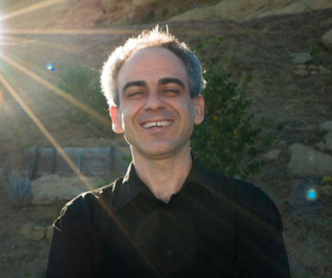

:::: {.hero-lab}
::: {.hero-grid}
::: {.hero-copy}
[Open-Sourcing the Code of Reality]{.hero-eyebrow}

# Marcelo Maciel Amaral

::: {.hero-roles}
Theoretical Physicist · Research Scientist · Founder
:::

::: {.hero-mission}
I investigate how information, symmetry, and geometry shape physical reality—from quantum gravity and aperiodic structures to quantum computing and energy-efficient intelligence. My work connects theoretical physics, computational research, and open science.
:::

::: {.hero-actions}
[Explore Research](research/index.qmd){.btn-lab-primary}
[Publications & DOIs](publications/index.qmd){.btn-lab-secondary}
[Living Projects](projects/index.qmd){.btn-lab-secondary}
:::
:::

::: {.hero-portrait}
{fig-alt="Portrait of theoretical physicist Marcelo Maciel Amaral"}
:::
:::
::::

**Current research:** Postdoctoral work at [Scripps College](https://www.scrippscollege.edu/) with [Professor Sarah Marzen](https://www.sarahmarzen.com/) on neural memory, prediction, and [energy-efficient computation](research/energy-efficient-ai/index.qmd).

::: {.qgr-spotlight}
## Quantum Gravity Research

Quantum gravity has been a central theme of my research, from gauge-theoretic foundations and relational dynamics to quasicrystalline spin foams and emergent spacetime geometry. These investigations connect mathematical physics with information theory and new approaches to quantum computation.

[Explore Quantum Gravity Research →](research/quantum-gravity/index.qmd)
:::

## Primary Research Directions

:::: {.card-grid}
::: {.lab-card}

[Spacetime & Physical Law]{.card-tag}

### [Quantum Gravity & Foundations](research/quantum-gravity/index.qmd)

Gauge theory, spin foams, discrete geometry, and the emergence of spacetime.

[Quantum Gravity](research/quantum-gravity/index.qmd) · [Gauge Theory](research/gauge-theory/index.qmd) · [Foundations](research/foundations/index.qmd) · [Riemann Hypothesis](research/riemann-hypothesis/index.qmd)
:::

::: {.lab-card}

[Quantum Information]{.card-tag}

### [Quantum Computing & Aperiodic Structures](research/quantum-computing/index.qmd)

Quasicrystals, topological quantum computation, quantum information, and new computational architectures.

[Explore direction →](research/quantum-computing/index.qmd)
:::

::: {.lab-card}

[Memory & Prediction]{.card-tag}

### [Information Theory & Energy-Efficient AI](research/energy-efficient-ai/index.qmd)

Memory, prediction, information geometry, neural computation, and efficient intelligent systems.

[Energy-Efficient AI](research/energy-efficient-ai/index.qmd) · [Information Geometry](research/information-geometry/index.qmd)
:::
::::

## Current Research & Open-Source Projects

:::: {.card-grid}
::: {.lab-card}

Manuscript in Preparation

### [Hybrid Adaptive Networks](projects/hybrid-adaptive-networks.qmd)

Postdoctoral research with Sarah Marzen at Scripps College on memory, prediction, adaptation, and energetic costs in neural systems.

[Project Scope & Status](projects/hybrid-adaptive-networks.qmd)
:::

::: {.lab-card}

Preprint + MIT Code

### [Quasicrystal Inflation Code (QIC)](projects/quasicrystal-inflation-code.qmd)

Simulation of Fibonacci anyon fusion and braiding inside a constrained qubit chain obeying Fibonacci inflation rules.

[Project Page](projects/quasicrystal-inflation-code.qmd) · [Read Article](publications/articles/fibonacci-quasicrystal-inflation-code/index.qmd)
:::

::: {.lab-card}

Preprint + Simulation Suite

### [Tiling Space Cosmology](projects/tiling-space-cosmology.qmd)

Computational exploration of tiling spaces, quasicrystal growth, and cosmological scaling.

[Project Page](projects/tiling-space-cosmology.qmd) · [GitHub](https://github.com/macielamaral/tiling-space-cosmology)
:::
::::

[View All Research Projects →](projects/index.qmd)

## Featured Scientific Publications



[View Complete Bibliography & Download BibTeX →](publications/index.qmd)

## Latest Writing & Essays

::: {#latest-writing}
:::

[Browse All 14 Essays & Series Posts →](blog/index.qmd) · [Technical Research Notes →](notes/index.qmd)

## Open Science & Collaboration

I share mathematical derivations and computational models through publications and open-source software. I also welcome scientific collaboration and technical consulting through [Gauge Freedom](venture/index.qmd).

## Academic & Professional Profiles

::: {.profile-links-bar}
[Google Scholar](https://scholar.google.com/citations?user=5vlU_PcAAAAJ&hl=en)
[GitHub (@macielamaral)](https://github.com/macielamaral)
[ResearchGate](https://www.researchgate.net/profile/Marcelo-Amaral-2)
[Wolfram Community](https://community.wolfram.com/web/mramaciel)
[LinkedIn](https://www.linkedin.com/in/marcelo-maciel-amaral-344842162/)
[X / Twitter (@Amaral12358)](https://twitter.com/Amaral12358)
[Instagram](https://www.instagram.com/marcelomacielamaral/)
[Medium](https://medium.com/@marcelomacielamaral/)
[Facebook](https://www.facebook.com/profile.php?id=61559319246818)
[Creative Work & Books](creator/index.qmd)
:::
