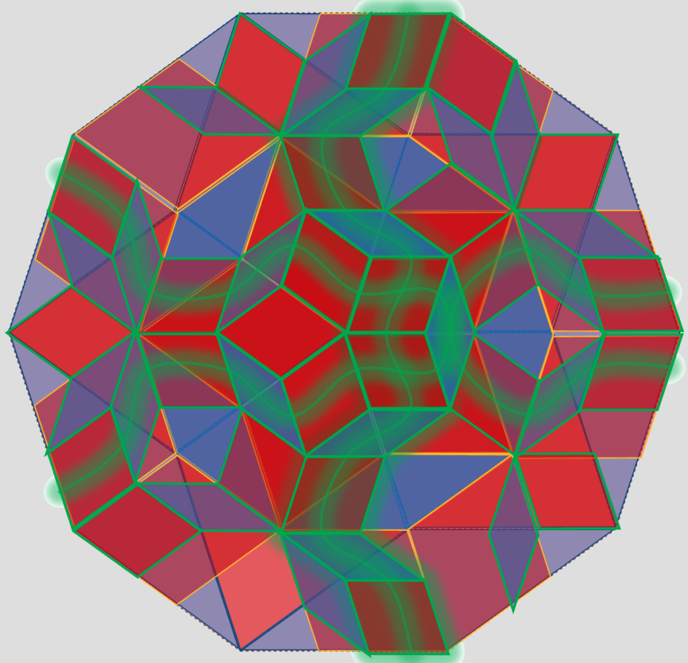

::: {.project-meta}
**Domain:** [Topological Quantum Computing](../research/quantum-computing/index.qmd)  
**Research Status:** Active — Preprint & Open-Source Code (v1.1)  
**Source Repository:** [github.com/macielamaral/quasicrystal-inflation-code](https://github.com/macielamaral/quasicrystal-inflation-code) (MIT License)  
**Primary Preprint:** [arXiv:2506.21643](https://arxiv.org/abs/2506.21643) · **Zenodo DOI:** *Pending explicit deposit*  
**Full Structured Article:** [Read Website Article →](../publications/articles/fibonacci-quasicrystal-inflation-code/index.qmd)
:::

## Scientific Question & Conceptual Overview

Can universal non-abelian topological quantum computation—canonically formulated in terms of physical Fibonacci anyons in 2D topological phases—be faithfully encoded, simulated, and benchmarked inside standard qubit arrays governed by 1D quasicrystal growth rules?

Building on our 2022 *Symmetry* study showing that Fibonacci quasicrystal tiling spaces share the fusion-dimension growth and projection algebra of Fibonacci anyons [@amaral2022anyonic], the **Quasicrystal Inflation Code (QIC)** constructs an explicit isometric embedding of the Fibonacci fusion tree into a 1D chain of qubits obeying the golden-mean "no adjacent `00`" local constraint [@amaral2025qic].

{width="540px" fig-alt="Geometric ribbon phason flip diagram illustrating quasicrystal rearrangement analogous to anyonic braiding"}

## Mathematical Formulation

Let $\mathcal{F}_n \subset (\mathbb{C}^2)^{\otimes n}$ denote the subspace of $n$-qubit computational basis strings $|x_1 x_2 \dots x_n\rangle$ satisfying $x_i x_{i+1} \neq 00$ for $1 \le i < n$. Its dimension satisfies the Fibonacci recurrence

$$
\dim \mathcal{F}_n = F_{n+2}, \qquad \lim_{n \to \infty} \frac{\dim \mathcal{F}_{n+1}}{\dim \mathcal{F}_n} = \varphi = \frac{1 + \sqrt{5}}{2}.
$$

Via an explicit inflation isometry $V$ and local Temperley–Lieb generators $\{E_i\}$ acting on $\mathcal{F}_n$ with loop parameter $\varphi$, the braid generators

$$
\sigma_i = e^{-4\pi i / 5} P_{\mathbf{1}}^{(i)} + e^{3\pi i / 5} P_{\tau}^{(i)}
$$

satisfy exact unitarity $\sigma_i^\dagger \sigma_i = \mathbf{1}$ and the Artin braid relation $\sigma_i \sigma_{i+1} \sigma_i = \sigma_{i+1} \sigma_i \sigma_{i+1}$ on the physical Fibonacci subspace.

## Main Verified Results & Code

- **`src/qic_core.py`** in [`quasicrystal-inflation-code`](https://github.com/macielamaral/quasicrystal-inflation-code) implements basis enumeration, the inflation isometry $V$, Temperley–Lieb projectors, unitary braid operators, local constraint Hamiltonians, and automated algebraic verification checks.
- Integrated as a gate-based benchmark engine inside [GaugeBench](gaugebench.qmd).

## Collaborators & Lineage

- **2025 QIC Framework & Code:** Marcelo M. Amaral [@amaral2025qic; @amaral2025qic_software].
- **2022 Quasicrystal–Anyon Correspondence:** Marcelo Amaral, David Chester, Fang Fang, and Klee Irwin [@amaral2022anyonic].

## References
