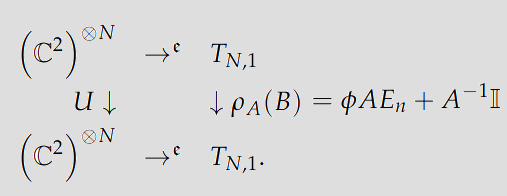

::: {.project-meta}
**Epistemic Status:** [arXiv Preprint + Verified Open-Source Software]{.status-pill .status-preprint}  
**arXiv Preprint:** [arXiv:2506.21643 [quant-ph]](https://arxiv.org/abs/2506.21643) · [arXiv PDF](https://arxiv.org/pdf/2506.21643.pdf) · **DOI:** [10.48550/arXiv.2506.21643](https://doi.org/10.48550/arXiv.2506.21643)  
**Source Repository:** [github.com/macielamaral/quasicrystal-inflation-code](https://github.com/macielamaral/quasicrystal-inflation-code) (MIT License, v1.1)  
**Associated Project:** [Aperiodic Topological Quantum Computing & Quasicrystal Inflation Codes](../../../projects/quasicrystal-inflation-code.qmd)
:::

## Abstract

Fibonacci anyons provide a dense, universal gate set for fault-tolerant topological quantum computation through braiding alone, yet direct hardware realization of non-abelian anyonic quasiparticles remains challenging. Building upon the correspondence between Fibonacci anyon fusion trees and 1D/2D Fibonacci quasicrystal tiling spaces [@amaral2022anyonic], the **Quasicrystal Inflation Code (QIC)** embeds Fibonacci fusion subspaces isometrically inside standard 1D qubit chains subject to the local golden-mean constraint forbidding adjacent `00` bit pairs [@amaral2025qic]. Within this constrained subspace, local Temperley–Lieb projectors and $F$/$R$-move braid generators satisfy exact algebraic coherence, unitarity, and Artin braid relations, enabling transparent simulation and hardware benchmarking on gate-based quantum processors.

## 1. Physical & Mathematical Motivation

In the $\mathrm{SU}(2)_3$ (integer-spin Fibonacci) modular tensor category, there is a single nontrivial topological charge $\tau$ alongside the vacuum $\mathbf{1}$, governed by the non-abelian fusion rule

$$
\tau \otimes \tau = \mathbf{1} \oplus \tau, \qquad \mathbf{1} \otimes \tau = \tau \otimes \mathbf{1} = \tau.
$$ {#eq-fusion}

Remarkably, the exact same combinatorial recurrence governs 1D Fibonacci substitution words ($1 \mapsto 10$, $0 \mapsto 1$) and cut-and-project Fibonacci quasicrystals [@amaral2021statesum; @amaral2022fifthroot; @amaral2022anyonic].

{fig-alt="Schematic correspondence between topological quantum computing fusion states and Fibonacci quasicrystal inflation spaces"}

## 2. Constrained Hilbert Space & Inflation Isometry

::: {#def-fib-space}
### Golden-Mean Qubit Subspace
For an $n$-qubit register $(\mathbb{C}^2)^{\otimes n}$, define the constrained Fibonacci subspace $\mathcal{F}_n$ spanned by computational basis bitstrings with no adjacent zeros:

$$
\mathcal{F}_n = \operatorname{span}\Bigl\{\, |x_1 x_2 \dots x_n\rangle \in (\mathbb{C}^2)^{\otimes n} \;\Big|\; x_i \in \{0,1\},\; (x_i, x_{i+1}) \neq (0,0) \;\forall\, 1 \le i < n \,\Bigr\}.
$$ {#eq-subspace}
:::

Let $\varphi = \frac{1+\sqrt{5}}{2}$ denote the golden ratio ($\varphi^2 = \varphi + 1$). Enforcing $(x_i, x_{i+1}) \neq (0,0)$ via the local penalty Hamiltonian

$$
H_{\mathrm{cons}} = \Delta \sum_{i=1}^{n-1} |00\rangle\langle 00|_{i,i+1} \qquad (\Delta > 0)
$$

identifies $\mathcal{F}_n = \ker H_{\mathrm{cons}}$ as the zero-energy ground-state manifold.

| Qubits $n$ | Allowed Basis Strings in $\mathcal{F}_n$ | $\dim \mathcal{F}_n = F_{n+2}$ | Full Register $2^n$ |
|:---:|:---|:---:|:---:|
| 1 | `0`, `1` | 2 | 2 |
| 2 | `01`, `10`, `11` | 3 | 4 |
| 3 | `010`, `011`, `101`, `110`, `111` | 5 | 8 |
| 4 | `0101`, `0110`, `0111`, `1010`, `1011`, `1101`, `1110`, `1111` | 8 | 16 |
| 5 | 13 golden-mean bitstrings | 13 | 32 |

: Exact dimension growth of the constrained Fibonacci qubit space $\mathcal{F}_n$ vs. unconstrained $2^n$ Hilbert space. {#tbl-dimensions}

## 3. Temperley–Lieb Projectors & Unitary Braid Gates

On the two-dimensional fusion channel $\tau \otimes \tau \otimes \tau \to \tau$ (represented locally by three-site configurations $|101\rangle \leftrightarrow |\mathbf{1}\rangle$ and $|111\rangle \leftrightarrow |\tau\rangle$ bounded by `1`s), basis change between fusion orderings is governed by the real symmetric unitary $F$-matrix:

$$
F = \begin{pmatrix} \varphi^{-1} & \varphi^{-1/2} \\ \varphi^{-1/2} & -\varphi^{-1} \end{pmatrix}, \qquad F^\dagger F = F^2 = I_2,
$$ {#eq-fmatrix}

where $\varphi^{-2} + \varphi^{-1} = 1$ guarantees exact unitarity. Together with the diagonal topological twist phases $R = \operatorname{diag}(e^{-4\pi i/5},\, e^{3\pi i/5})$, local Temperley–Lieb generators $E_i$ of loop fugacity $d = \varphi$ satisfy:

::: {#thm-tl-braid}
### Temperley–Lieb & Artin Braid Consistency
On $\mathcal{F}_n$, the local projection operators $\{E_i\}$ and elementary braid operators $\sigma_i = e^{3\pi i/5} I + e^{-3\pi i/5} E_i = e^{3\pi i/5} I + \bigl(e^{-4\pi i/5} - e^{3\pi i/5}\bigr) \varphi^{-1} E_i$ satisfy:

1. **Temperley–Lieb relations:** $E_i^2 = \varphi E_i$, $E_i E_{i\pm 1} E_i = E_i$, and $[E_i, E_j] = 0$ for $|i-j| \ge 2$.
2. **Subspace closure & unitarity:** $[\sigma_i, H_{\mathrm{cons}}] = 0$ and $\sigma_i^\dagger \sigma_i = I_{\mathcal{F}_n}$.
3. **Artin braid group relation:** $\sigma_i \sigma_{i+1} \sigma_i = \sigma_{i+1} \sigma_i \sigma_{i+1}$.
:::

## 4. Open-Source Implementation & Reproducibility

The companion MIT-licensed Python package [`quasicrystal-inflation-code`](https://github.com/macielamaral/quasicrystal-inflation-code) [@amaral2025qic_software] provides deterministic verification of every algebraic identity above:

```python
import numpy as np

phi = (1.0 + np.sqrt(5.0)) / 2.0
F = np.array([[1.0 / phi, 1.0 / np.sqrt(phi)],
              [1.0 / np.sqrt(phi), -1.0 / phi]])
R = np.diag([np.exp(-4j * np.pi / 5.0), np.exp(3j * np.pi / 5.0)])
B = F @ R @ F

assert np.allclose(F @ F, np.eye(2))
assert np.allclose(B.conj().T @ B, np.eye(2))
```

In [`src/qic_core.py`](https://github.com/macielamaral/quasicrystal-inflation-code), multi-qubit chains $\mathcal{F}_n$, inflation isometries $V: \mathcal{F}_n \hookrightarrow \mathcal{F}_{n+1}$, Temperley–Lieb operators $E_i$, and multi-strand braid circuits are constructed and unit-tested, and exposed to hardware/simulator benchmark suites via [GaugeBench](../../../projects/gaugebench.qmd) [@amaral2026gaugebench].

::: {.content-visible when-format="html"}
## References
:::
