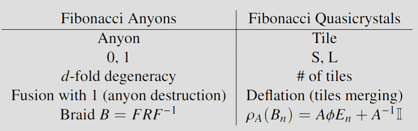

## Scientific Question & Motivation

Topological quantum computing (TQC) protects quantum information non-locally inside degenerate fusion spaces of non-abelian anyons, implementing fault-tolerant gates via braid group representations that are immune to local perturbations. **Fibonacci anyons** ($\tau \times \tau = \mathbf{1} \oplus \tau$) are universal for quantum computation by braiding alone, yet engineering and controlling physical non-abelian quasiparticles remains experimentally demanding.

Our research explores an alternative algebraic and geometric bridge: **aperiodic topological quantum computing**, exploiting the mathematical isomorphism between the fusion Hilbert spaces of Fibonacci anyons and the constrained tiling spaces of 1D and 2D Fibonacci quasicrystals [@amaral2022anyonic; @amaral2025qic], alongside topological qubits derived from 3-manifold fundamental groups, Fricke character varieties, and magic-state geometries [@planat2018manifolds; @planat2019magic; @planat2022fricke].

{fig-alt="Diagram mapping Fibonacci anyon fusion spaces and braid gates to Fibonacci quasicrystal tiling space projectors"}

## Core Algebraic Mechanism

A 1D Fibonacci quasicrystal word over $\{0, 1\}$ generated by the substitution rule $1 \mapsto 10$, $0 \mapsto 1$ forbids adjacent zeros (`00`). On an $n$-qubit chain, the constrained subspace

$$
\mathcal{H}_{\mathrm{Fib}}^{(n)} = \operatorname{span}\bigl\{\, |x_1 x_2 \dots x_n\rangle \in (\mathbb{C}^2)^{\otimes n} \;\big|\; x_i x_{i+1} \neq 00 \text{ for all } i \,\bigr\}
$$

has dimension $\dim \mathcal{H}_{\mathrm{Fib}}^{(n)} = F_{n+2}$, matching the fusion-tree multiplicity of Fibonacci anyons. Temperley–Lieb projectors $E_i$ with loop fugacity $d = \varphi = \frac{1+\sqrt{5}}{2}$ satisfying

$$
E_i^2 = d\, E_i, \qquad E_i E_{i\pm 1} E_i = E_i, \qquad [E_i, E_j] = 0 \quad (|i-j| \ge 2)
$$

yield unitary Jones–Wenzl / braid representations $B_i = A\, \mathbf{1} + A^{-1} E_i$ ($A = e^{3\pi i/5}$) that can be compiled and benchmarked directly on gate-based qubit simulators and hardware [@amaral2025qic].

## Fibonacci Forbidden-Word Hamiltonians

The preprint *A Hierarchy of Fibonacci Forbidden-Word Hamiltonians* extends the constrained-word approach from the golden chain through the plastic chain toward aperiodic Fibonacci order [@amaral2025fibonacci]. It studies how progressively excluding longer forbidden patterns reduces the growth rate of the ground-state language. The plastic chain ($K=4$) forbids `SS` and `LLL`.

Within this construction, the paper identifies exact Temperley–Lieb braiding compatibility at the base rung ($K=3$); higher rungs describe constrained aperiodic Hamiltonian codes. This distinction connects the hierarchy to the QIC braid framework while keeping the scope of the higher-rung models explicit.

## Living Projects & Open-Source Code

Related work on Fibonacci cut-and-project windows develops patch-frequency and entropy estimates [@amaral2026fibonacciwindows]. Its connections to prime-power sums are described in the [Riemann Hypothesis research direction](../riemann-hypothesis/index.qmd).

- **[Quasicrystal Inflation Code (QIC)](../../projects/quasicrystal-inflation-code.qmd)** — Full theoretical formulation (`arXiv:2506.21643`), [detailed research article](../../publications/articles/fibonacci-quasicrystal-inflation-code/index.qmd), and MIT-licensed Python package (`quasicrystal-inflation-code`).
- **[GaugeBench](../../projects/gaugebench.qmd)** — Verifiable quantum benchmarking wrapping gate-based (QIC) and annealing engines with Content-Addressable Receipts (`gaugebench`).

## Selected Publications

- **[A Hierarchy of Fibonacci Forbidden-Word Hamiltonians: From the Golden Chain to the Plastic Chain and Aperiodic Order](https://arxiv.org/abs/2511.10672)** — Marcelo Maciel Amaral (preprint, November 9, 2025). [DOI](https://doi.org/10.48550/arXiv.2511.10672) · [PDF](https://arxiv.org/pdf/2511.10672).
- **Consistent Simulation of Fibonacci Anyon Braiding within a Qubit Quasicrystal Inflation Code** — M. M. Amaral (*arXiv:2506.21643*, 2025).
- **Exploiting Anyonic Behavior of Quasicrystals for Topological Quantum Computing** — M. Amaral, D. Chester, F. Fang, K. Irwin (*Symmetry* 14(9), 1780, 2022).
- **Fricke Topological Qubits** — M. Planat, D. Chester, M. M. Amaral, K. Irwin (*Quantum Reports* 4(4), 523–532, 2022).
- **Character Varieties and Algebraic Surfaces for the Topology of Quantum Computing** — M. Planat, M. M. Amaral et al. (*Symmetry* 14(5), 915, 2022).
- **Group Geometrical Axioms for Magic States of Quantum Computing** — M. Planat, R. Aschheim, M. M. Amaral, K. Irwin (*Mathematics* 7(10), 948, 2019).
- **Universal Quantum Computing and Three-Manifolds** — M. Planat, R. Aschheim, M. M. Amaral, K. Irwin (*Symmetry* 10(12), 773, 2018).

## References
